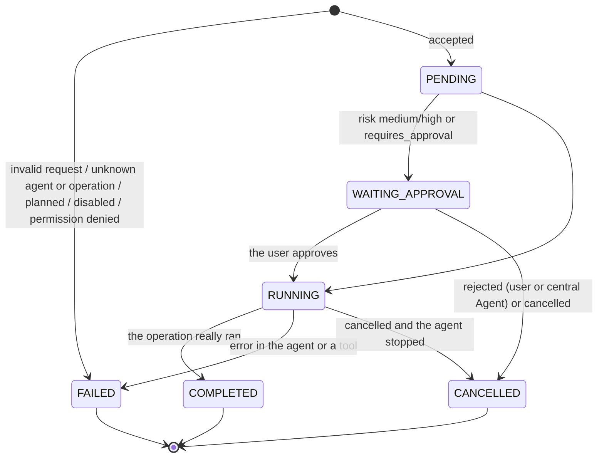

# COSOUND – Agent API and Agent Protocol (contract v1)

Status: **implemented** (Prompt 06, 2026-11-26) in `desktop/src-tauri/src/agents/` (`protocol.rs`, `runtime.rs`).
JSON Schemas: `packages/contracts/` (`task-request`, `task-result`, `event`, `agent-manifest`, `api-message`).
This document supersedes the draft envelope of `docs/architecture/MULTI-AGENT-ARCHITECTURE.md` §5 where they differ
(statuses, `errors[]`, `approval`); its ideas `needs`, `proposed_daw_ops` and `basis` are kept.

## 1. Agent API (transport-independent)
One JSON message in, one JSON message out: `Runtime::handle(&Value) -> Value`. Whatever the transport chosen with the partner
(decision D-1: in-process, stdio, MCP, HTTP/WebSocket through a local bridge), the adapter only converts its messages into these.

Every message may carry `"contract_version": "1"`; any other value is refused with `PROTOCOL_VERSION`.

| `type` | Fields | Answer `data` |
|---|---|---|
| `registry.get` | – | `{ agents[], tools[], permissions[] }` with live state (enabled, granted, used_by) |
| `task.submit` | `request`: TaskRequest | TaskResult (final, or `RUNNING` if `async`, or `WAITING_APPROVAL`) |
| `task.status` | `task_id` | TaskResult |
| `task.list` | `limit` (default 50) | TaskResult[] (newest first) |
| `task.cancel` | `task_id` | TaskResult (`CANCELLED`, or still `RUNNING` with cancellation requested) |
| `approval.list` | – | TaskResult[] waiting for approval |
| `approval.respond` | `approval_id`, `decision`: `reject` | TaskResult (`CANCELLED`). `approve` is refused: see §5 |
| `events.poll` | `since` (sequence number) | Event[] after `since` |

Answer envelope: `{ "contract_version": "1", "type": <same>, "ok": true, "data": … }` or
`{ …, "ok": false, "error": { "code", "message", "retryable" } }`. Unknown `type` → `MESSAGE_UNKNOWN`.

## 2. TaskRequest
```json
{
  "contract_version": "1",
  "request_id": "caller-side id (required)",
  "task_id": "optional: chosen by the caller, otherwise generated",
  "trace_id": "optional: shared by all tasks of one user request",
  "session_id": null, "project_id": null,
  "agent": "music_theory",
  "operation": "generate_bassline",
  "input": { "key": "A minor", "bpm": 124, "bars": 8, "genre": "melodic_techno" },
  "requested_by": "central_agent",
  "async": false
}
```
`input` is validated against the operation's JSON Schema in the manifest (`SCHEMA_INVALID` with the exact field otherwise).
Extra fields are accepted, so callers can send newer optional fields without breaking older agents.

## 3. TaskResult (every answer about a task)
Real example produced by step 5 of the MOCK scenario (result trimmed):
```json
{
  "contract_version": "1",
  "request_id": "melodic-techno-124-5",
  "task_id": "28121310-2d33-40b9-b940-8c4ff47e5e78",
  "trace_id": "2445baaf-476a-4beb-9e43-1e64563bd070",
  "session_id": null, "project_id": null,
  "agent": "sound_designer", "agent_version": "1.0.0", "operation": "suggest_sounds", "requested_by": "mock",
  "status": "COMPLETED",
  "result": { "role": "bass", "genre": "melodic_techno", "recipes": ["… sub_bass, acid_bass with variants …"], "installed_instruments": [], "presets_in_library": [] },
  "basis": "rule_based",
  "files": [],
  "tools_used": ["sound.recipes", "plugins.scanner", "plugins.catalog", "library.index"],
  "errors": [],
  "limitations": ["no software instrument was detected on this computer: the recipes apply to any synth, including the DAW's own instruments"],
  "needs": [], "proposed_daw_ops": [], "approval": null,
  "created_at_ms": 1795699465075, "started_at_ms": 1795699465075, "finished_at_ms": 1795699465077
}
```

| Field | Meaning |
|---|---|
| `request_id`, `task_id`, `trace_id` | identifiers (request = caller's, task = unique per task, trace = whole user request) |
| `agent`, `agent_version`, `operation` | who did what |
| `status` | see §4 |
| `result` | operation output; `null` unless `COMPLETED` |
| `basis` | where the values come from: `measured` · `rule_based` · `convention` (knowledge-base templates) · `estimated` · `web` (given by the caller, not verified) · `file_name` · `mixed` · `none` |
| `files` | files produced: `{ path, kind, bytes, sha256 }`, always inside COSOUND's `generated/` folder |
| `tools_used` | level-3 tools actually used (never another agent) |
| `errors` | `{ code, message, retryable }` |
| `limitations` | what was not done or not measured, in plain words |
| `needs` | work this agent suggests the central Agent may assign (`{ agent, operation, why, input }`); agents never call each other |
| `proposed_daw_ops` | DAW operations proposed, never executed by the proposing agent |
| `approval` | present while `WAITING_APPROVAL` |

## 4. Statuses and lifecycle
`PENDING` → `RUNNING` → `COMPLETED` | `FAILED` | `CANCELLED`, and `PENDING` → `WAITING_APPROVAL` → (user approves) `RUNNING` / (rejected) `CANCELLED`.


- `COMPLETED` means the operation actually ran. A planned operation is never `COMPLETED`: it fails with `NOT_IMPLEMENTED` and a
  limitation naming the missing component.
- Synchronous by default; with `"async": true` the call returns `RUNNING` and the result is polled (`task.status`, `events.poll`).
- Cancellation: tasks waiting (approval) are cancelled at once. Running tasks receive a cancellation flag; long operations check it
  (audio measurement checks it every 8192 frames). An operation that finishes before seeing the flag stays `COMPLETED`.
- Tasks left unfinished when the app closes are marked `CANCELLED` with error `INTERRUPTED` at the next start.
- Every task, including refused ones, is written to the activity log (`ail_tasks`, local SQLite).

## 5. Approvals (Safety Gate)
Operations with risk `medium`/`high` (or `requires_approval`) stop in `WAITING_APPROVAL` with:
```json
{ "approval_id": "1322ee6b-62aa-4e14-8a13-199a03fa9a1e", "task_id": "bdca10eb-…", "agent": "adaptive_workflow", "operation": "clear",
  "risk": "high", "summary": "Delete the whole workflow memory (needs the user's confirmation)", "approvable_by": "user", "requested_at_ms": 1795699465081 }
```
**Only the user can approve** (Agents page in the app). Through the Agent API the central Agent can list, reject or cancel, never
approve: `approval.respond` with `approve` answers `PERMISSION_DENIED`. This is the rule of `AGENT-INTEGRATION-LAYER.md` §5: even a
faulty Agent cannot skip the user's consent. Approvals and rejections are written to the operation register.

## 6. Errors
| Code | When | Retry? |
|---|---|---|
| `PROTOCOL_VERSION` | unsupported `contract_version` | no |
| `SCHEMA_INVALID` | missing/invalid field (message names it), invalid musical input | after fixing |
| `AGENT_UNKNOWN` / `OPERATION_UNKNOWN` | not in the registry | no |
| `NOT_IMPLEMENTED` | operation is `planned`; `limitations` says what is missing | no |
| `AGENT_DISABLED` | the user disabled the agent | after the user enables it |
| `PERMISSION_DENIED` | permission off, file outside authorized folders, approval by someone other than the user | after the user grants it |
| `DUPLICATE_TASK` | `task_id` already used | with another id |
| `FILE_NOT_FOUND` / `UNSUPPORTED_FORMAT` | input file missing / not measurable (WAV only today) | after fixing |
| `PRIVATE_DATA_REFUSED` | Adaptive Workflow refused a password, code, card/account number or key | no |
| `CHECKS_FAILED` | a generated part did not pass its musical checks (nothing is returned as valid) | with another seed |
| `NOT_FOUND` | memory item not found | no |
| `EXECUTION_FAILED` | internal error in a tool or agent | maybe |
| `CANCELLED` / `APPROVAL_REJECTED` / `INTERRUPTED` | stopped, rejected, app closed | resubmit |
| `TASK_UNKNOWN` / `ALREADY_FINISHED` / `APPROVAL_UNKNOWN` / `MESSAGE_UNKNOWN` | API-level errors | no |

## 7. Events
`events.poll` returns `{ seq, at_ms, kind, task_id, agent, operation, status, detail }` with kind `task.created`, `task.status`,
`task.cancel_requested`, `approval.requested`, `approval.resolved`, `agent.enabled`, `agent.disabled`. The last 2000 are kept in memory.

## 8. Versioning
- `contract_version` ("1") versions the envelopes; a breaking change will be "2" and both will be accepted during a transition.
- Each agent has its own semantic `version` in its manifest; `agent_version` is in every result.
- Inputs are additive: new optional fields do not break callers; removing or renaming a field needs a new agent major version.
