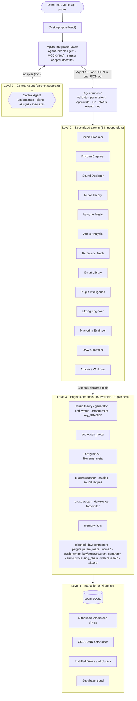

# COSOUND – Multi-Agent System architecture (Prompt 06)

Status: **implemented** for the specialized agents and their integration layer (2026-11-26). The central Agent is the partner's
component and is not part of this work. Related: `AGENTS.md` (responsibilities), `AGENT-PROTOCOL.md` (API and protocol),
`REGISTRIES.md` (agent and tool registries, permissions), `INTEGRATION-GUIDE.md` (for the partner),
`../architecture/AGENT-INTEGRATION-LAYER.md`, `../ARCHITECTURE-DIRECTIVE.md`.

## 1. Four levels

- **Level 1 – Central Agent.** Receives requests, plans, decides which agents to involve, collects and evaluates results. Not built here.
  Until it arrives the app runs `NoAgent` (release) or the **MOCK** port (development builds), which executes explicit commands only.
- **Level 2 – Specialized agents.** 13 modules in `desktop/src-tauri/src/agents/`, one per file, each implementing the `Agent` trait and
  declared in `packages/agents/<id>.json`. They never call each other and never talk to the user.
- **Level 3 – Engines and tools.** Deterministic Rust modules (`music/`, `audio/`, `library.rs`, `plugins.rs`, `sound.rs`, `daw.rs`,
  `memory.rs`), catalogued in `packages/agents/tools.json`. Planned tools are listed with the milestone that will build them.
- **Level 4 – Execution environment.** The user's computer: local database, authorized folders and drives, COSOUND's data folder, installed
  DAWs and plugins, the existing Supabase backend (accounts). Agents reach it only through tools and the execution context.

## 2. Components
| Component | File | Role |
|---|---|---|
| Agent Protocol | `agents/protocol.rs` | TaskRequest, TaskResult, statuses, errors, approvals, events |
| Agent Registry / Tool Registry | `agents/registry.rs` + `packages/agents/*.json` | manifests, tools, permissions (source of truth: JSON) |
| Input validation | `agents/schema.rs` | JSON Schema subset on every input |
| Agent runtime | `agents/runtime.rs` | executes tasks; permissions; approvals (user only); sync/async; cancellation; events; `ail_tasks` log; JSON Agent API |
| Execution context | `agents/mod.rs` (`Ctx`) | the only door to the computer: permission checks, authorized files, writes only in `generated/`, records tools/files/limitations |
| Agents | `agents/<id>.rs` | the 13 specialized agents |
| MOCK script | `agents/scenario.rs` | fixed collaboration script (tests and dev builds only) |
| AIL | `ail/mod.rs`, `ail/temp_test_connector.rs` | `AgentPort`; `NoAgent`; MOCK connector |
| Music Memory | `memory.rs`, table `memory_facts` | single local memory (workflow items for Adaptive Workflow) |
| UI | `src/pages/Agents.tsx`, `Chat.tsx`, `Settings.tsx` | agents, approvals, tasks, tools, workflow memory; MOCK commands in chat |

## 3. Communication
- Every task is a **TaskRequest** to the runtime and every answer a **TaskResult** (`AGENT-PROTOCOL.md`), with unique `task_id`, the
  caller's `request_id` and a `trace_id` shared by the tasks of one user request.
- **Collaboration without a second orchestrator.** An agent that needs another's work returns `needs[]` (agent, operation, why, input); the
  central Agent decides. Outputs flow between agents only because the central Agent passes them (e.g. the drums MIDI from Rhythm Engineer
  becomes an input of DAW Controller). A test checks that `tools_used` never contains an agent.
- **Events** (`events.poll`) report task creation, status changes, approval requests and answers, agent enable/disable.
- **Interfaces are versioned**: `contract_version` on every message, semantic `version` per agent.

## 4. Independence and modularity
- Each agent is one file + one manifest; it can be developed, tested (`agents/tests.rs` runs every available operation), replaced by a
  newer version (bump `version`), enabled or disabled by the user, and linked to new tools by declaring them.
- No circular dependencies: agents → tools → environment. Agents do not import each other.
- No duplicated responsibilities: measurement lives in one tool (`audio.wav_meter`) used by Audio Analysis, Mixing, Mastering and Reference
  Track; memory lives in `memory_facts` only.
- Adding an agent: write `<id>.rs`, add `<id>.json`, list it in `all_agents()` and `AGENT_IDS`; the registry test fails until code and
  manifest agree.

## 5. Security and authorizations
| Requirement (Prompt 06 §8) | How |
|---|---|
| Granular permissions | per operation in the manifest; checked before running; user toggles in Settings (`REGISTRIES.md` §3) |
| Controlled file access | `Ctx::authorized_file`: only authorized library folders (drive online), imported files, COSOUND's folder |
| Authorized DAW access | detection behind `daw.detect`; control (`daw.control`) not grantable until connectors exist |
| Personal data | everything local; Adaptive Workflow refuses passwords, codes, card/account numbers and keys; off by default |
| Credentials | agents never receive or store credentials; the account session stays in the UI |
| Destructive operations | risk levels; medium/high wait for the user's approval; only the user can approve |
| Confirmation for sensitive operations | Agents page: Approve / Reject |
| Activity log | `ail_tasks` (every task, also refused ones) + operation register for approvals, memory changes, agent enable/disable |
| Stopping operations | `task.cancel` and the Stop button; long tools poll the cancellation flag |
| No unlimited access | agents get a `Ctx`, not the file system; writes only in `generated/`; no network access |

## 6. Dependencies
- **No new third-party crates or npm packages** for Prompt 06. Used: `serde`, `serde_json`, `rusqlite`, `sha2`, `uuid` (already in
  `Cargo.toml`), `tempfile` (tests). Audio measurement (BS.1770 loudness, true peak), WAV reading, base64, JSON Schema subset and key
  finding are implemented in the project.
- Database: migration `desktop/src-tauri/migrations/002_agents.sql` (`ail_tasks`, `memory_facts`, as designed in `DATABASE.md`).
- Knowledge used at runtime: arrangement templates, sound recipes, synth profiles, loudness targets and mixing conventions from
  `docs/knowledge/` (cited in results through `source`).
- External components still required: DAW connectors (M4), voice engine (M5), audio tempo/key/structure/stems (M6), plugin parameter
  maps (M7), processing chain (M9), AI Core or the central Agent for language understanding and web research.

## 7. What is real, simulated, external, waiting
| | Items |
|---|---|
| **Implemented and tested** | runtime, protocol, API, registries, permissions, approvals, cancellation, events, activity log; 36 operations of 12 agents on real engines (theory and MIDI, WAV measurements, library, plugins, DAW detection and plans, memory) |
| **Simulated** | only the MOCK connector and its fixed scenario script, labelled as simulation, development builds only |
| **Needs external components** | 17 planned operations: Voice-to-Music (all), audio tempo/key/structure/stems, synth programming, parameter maps, mix moves, mastering processing, DAW execution, online research, natural-language brief, learning from DAW history |
| **Needs the central Agent's specs** | transport and adapter (D-1), where reasoning runs (D-2), models (D-3), memory ownership (D-4), authentication (D-5), streaming/cancellation semantics (D-6) |

## 8. Technical limits now
- WAV only for measurements; loudness for mono/stereo only; coarse frequency bands (2nd-order filters), no spectrum or masking analysis.
- No BPM/key detection from audio; BPM/key in the library come from file names.
- MIDI generation: 4/4, one chord per bar, rule-based melodies.
- DAW plans are not executed; no DAW is connected.
- Agents run in-process with the app; tasks are synchronous unless `async`; cancellation is cooperative.
