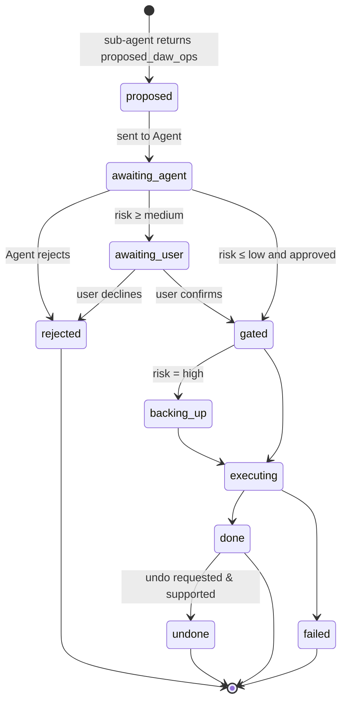

# Agent Integration Layer (AIL) – specification v0.1

Status: **PROVISIONAL** – the stable part (internal interface, contract, state) is final for
implementation; the adapter toward the central Agent is ⏳ until the Agent's code is analyzed.
Required by `docs/ARCHITECTURE-DIRECTIVE.md` (parallel-development directive §1–2).

## 1. Purpose
The AIL is the **only** place in COSOUND that knows the central Agent exists. Everything else (UI,
sub-agents, DAW Controller) talks to the AIL through a stable internal interface. When the Agent
arrives, we write one adapter; nothing else changes.

It does **not** plan, choose sub-agents or decide anything: that is the central Agent's job.

## 2. Responsibilities (directive §1)

| Responsibility | How |
|---|---|
| Send requests to the Agent | `AgentPort.send(UserTurn)` via the active adapter |
| Receive responses | `AgentPort` emits `AgentEvent`s (text deltas, capability calls, op approvals, final) |
| Manage operations | tracks every `OpRequest` from proposal → approval → Safety Gate → result |
| Communicate with sub-agents | executes the Agent's capability calls on the Capability Bus, returns `TaskResult` |
| Errors | typed errors (§6), never swallowed, always returned to the Agent and shown to the user |
| Auth & authorization | attaches user identity/entitlements; checks the capability is allowed for the plan and permitted by the user before dispatch |
| Session context | `session_id`, project ref, conversation history pointer, memory snapshot ref |
| Operation status | persistent table `ail_tasks` / `op_log` (see `DATABASE.md`), events to the UI |

## 3. Internal interface (stable)

```ts
// Rust trait in desktop/src-tauri/src/ail/port.rs; shown in TS-like notation.
interface AgentPort {
  id: string                                   // "temp-test-connector" | "<partner-agent>"
  isTemporary: boolean                         // UI shows a banner when true
  connect(session: SessionInfo): Promise<void>
  send(turn: UserTurn): Promise<void>          // user text/voice transcript/attachments refs
  onEvent(cb: (e: AgentEvent) => void): void
  deliverResult(r: TaskResult | OpResult): Promise<void>  // results of calls the Agent made
  cancel(taskId: string): Promise<void>
  health(): Promise<PortHealth>
  disconnect(): Promise<void>
}

type AgentEvent =
  | { kind: "assistant_text", delta: string, final: boolean }
  | { kind: "capability_call", request: TaskRequest }        // Agent asks a sub-agent
  | { kind: "op_decision", opId: string, decision: "approve" | "reject", reason?: string }
  | { kind: "ask_user", question: string, options?: string[] }
  | { kind: "error", error: AilError }
```

The AIL exposes to the Agent a **capability catalog** generated from `packages/agents/*/agent.yaml`
(name, description, JSON Schema input/output, risk level, required permissions). The adapter
translates this catalog into whatever the Agent consumes (tool list, MCP tools, function schemas…).

## 4. Contract v1 (shared, `packages/contracts/`)
`TaskRequest`, `TaskResult`, `OpRequest`, `OpResult` – shape in `MULTI-AGENT-ARCHITECTURE.md` §5, plus:
- `contract_version: "1"` on every message; adapters reject unknown major versions.
- `trace_id` propagated across AIL → Bus → Engine → DAW for the op log.
- `basis` on analysis results: `"measured" | "estimated" | "web"` (generalizes `measured`), so no
  component can present text research or estimates as measurements.
- Large payloads only as `artifact://<project>/<path>#sha256`.

## 5. Lifecycle of an operation


The Safety Gate, not the Agent, enforces the user-confirmation and backup steps: even an Agent bug
cannot skip them.

## 6. Errors

| Code | Meaning | Who handles |
|---|---|---|
| `AGENT_UNAVAILABLE` | adapter cannot reach the Agent | UI banner; local features still work |
| `CAPABILITY_UNKNOWN` / `SCHEMA_INVALID` | bad call from the Agent | returned to Agent, logged |
| `NOT_IMPLEMENTED` | capability is in the catalog as `planned`, engine not built yet | returned to Agent; never simulated |
| `NOT_ENTITLED` | plan doesn't include the feature | returned to Agent + upgrade hint in UI |
| `PERMISSION_REQUIRED` | OS permission missing (mic, Accessibility…) | UI asks just-in-time, task resumes or fails |
| `SUBAGENT_FAILED` | tool/engine error, with cause | returned to Agent (retry/alternative/ask user) |
| `OP_REJECTED` / `OP_FAILED` | user/agent declined or DAW op failed | op card in UI, exact DAW message |
| `TIMEOUT` / `CANCELLED` | long job exceeded limit or user stopped | job manager |

## 6b. Implementation status (Prompt 04, 2026-11-24)
- Implemented in `desktop/src-tauri/src/ail/`: `AgentPort` trait (synchronous `send` returning events; streaming = D-6), `NoAgent` port (release default, returns `AGENT_UNAVAILABLE`), Capability Bus `dispatch`, task list shown in the Agents panel.
- Catalog: `packages/agents/registry.json` (one JSON file for the 12 sub-agents instead of one `agent.yaml` each, until packs carry instructions/schemas). A test fails if a capability marked `available` is not wired on the Bus.
- Not yet: Safety Gate confirmations and backups (no agent-proposed DAW operation exists yet), `op_decision` / `ask_user` events.

## 6c. Implementation status (Prompt 06, 2026-11-26)
- The Capability Bus `dispatch` and `packages/agents/registry.json` are replaced by the **agent runtime** and the **Agent API**
  (`desktop/src-tauri/src/agents/`, spec in `docs/agents/AGENT-PROTOCOL.md`). Catalog: one manifest per agent in
  `packages/agents/<id>.json` + `tools.json` + `permissions.json`; JSON Schemas in `packages/contracts/`.
- `AgentPort::send(text, api)`: a port reaches the agents only through the JSON Agent API (`Runtime::handle`), the same interface the
  partner adapter will use. `AgentEvent::TaskResult` carries the full TaskResult.
- Statuses: PENDING, RUNNING, WAITING_APPROVAL, COMPLETED, FAILED, CANCELLED (they replace the draft `ok/partial/needs_input/error`).
- Safety Gate for agent operations: medium/high risk waits for approval; only the user approves (the Agent API refuses `approve`).
- Persistent table `ail_tasks` (migration `002_agents.sql`); events via `events.poll`.
- Still not done: DAW operations execution (no connector), backups before risky DAW changes (no DAW operation exists yet), `ask_user`.

## 7. Temporary test connector (directive §2)
Since Prompt 06 this is the **MOCK central Agent connector** (`ail/temp_test_connector.rs`, port id `mock-central-agent`), labelled
"MOCK (simulation)" everywhere. Commands: `/call <agent>.<operation> {json}`, `/scenario` (fixed six-step script in `agents/scenario.rs`),
`/status <task_id>`, `/cancel <task_id>`, `/agents`. It uses only the Agent API, so replacing it does not touch any agent
(test `mock_is_replaceable_by_a_json_connector`). The original description below still applies.

`ail/adapters/temp_test_connector` – **TEMPORARY, to be removed when the real Agent is integrated.**
- Purpose: let us develop and test sub-agents, Bus, Safety Gate and UI end to end without the Agent.
- What it does: the developer (or a scripted test) issues **explicit capability calls**
  (e.g. `music_theory.generate_bassline {key:"A minor",…}`) and op approvals. It has **no language
  understanding and no planning**; it does not pretend to be an assistant.
- UI: persistent banner "Agent centrale non collegato – connettore di test temporaneo"; free-text chat
  messages get the fixed reply "Il connettore di test accetta solo comandi espliciti".
- Isolation: compiled only in development builds (Cargo feature `temp-connector`), never shipped.
- Replacement: implement `AgentPort` for the real Agent, switch the configured adapter, delete the folder.

## 8. Decisions waiting for the Agent (documented, not blocking)

| ID | Decision | Options | Depends on |
|---|---|---|---|
| D-1 | Transport AIL ↔ Agent | in-process library · local process (stdio/MCP) · remote service (HTTPS/WebSocket via a local bridge) | Agent language/runtime/location |
| D-2 | Where sub-agent reasoning runs | AI Core (ours) · Agent's own sub-agent framework (packs exported) | Agent framework |
| D-3 | Which LLM(s) | Agent's choice vs AI Core default | Agent's provider |
| D-4 | Memory ownership | Agent memory vs COSOUND Music Memory as source of truth (proposal: COSOUND stores, Agent retrieves via capability) | Agent memory design |
| D-5 | Auth between app and Agent | Supabase JWT forwarded · Agent-specific credentials | Agent hosting |
| D-6 | Streaming & cancellation semantics | — | Agent API |

## 9. Integration procedure when the Agent arrives (directive §4)
1. Analyze code: language, framework, request loop, tool mechanism, memory, multi-agent support, limits → `AGENT-ANALYSIS.md`.
2. Check compatibility with §3–4; list gaps.
3. Write the adapter (only new code); resolve D-1…D-6 and record them in `DECISIONS.md`.
4. Map capability catalog → Agent's tool format; no duplicated components (remove anything the Agent already does better only with the user's approval).
5. Test: contract tests (schema), one end-to-end flow per sub-agent, error paths, cancellation.
6. Verify coordination: `needs` routing, op approvals, Safety Gate enforcement.
7. Document changes; delete `temp_test_connector`; update `COSOUND_PROJECT_STATUS.md`.
Never modify the Agent's code without authorization.
