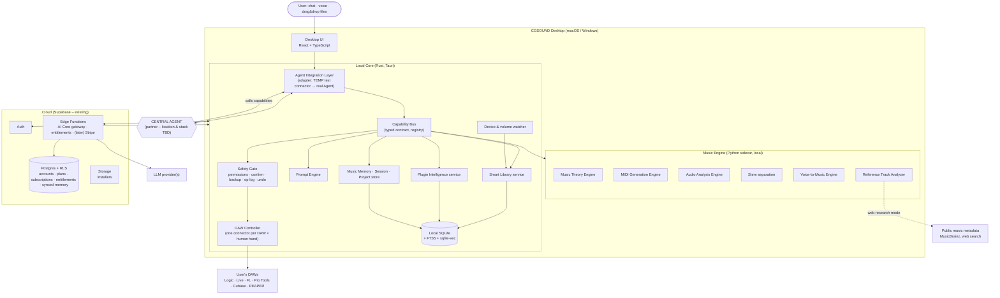
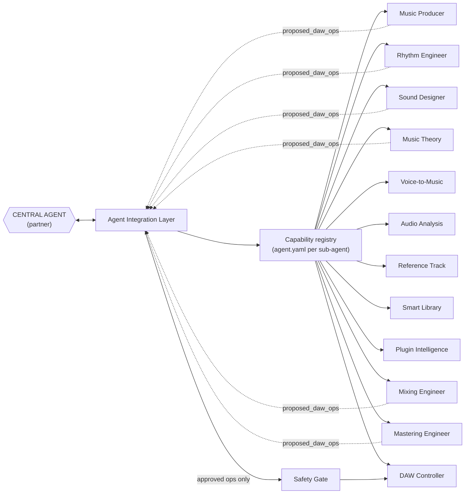
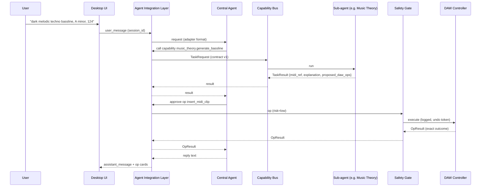

# COSOUND – Software architecture (Prompt 03)

Version 0.3 · 2026-11-24 · Status: **PROVISIONAL** – complete except for the parts that depend on the
central Agent, which has not been delivered yet (see §1 and `README.md` → "Decisions waiting for the Agent").

Inputs: Prompt 01 (site, Supabase, `docs/SETUP.md`), Prompt 02 (`docs/knowledge/`),
`docs/ARCHITECTURE-DIRECTIVE.md` (central Agent + parallel development),
`MULTI-AGENT-ARCHITECTURE.md` (sub-agent roles, contract, safety, human-hand principle).

---

## 1. The central Agent

| Question (Prompt 03 §1) | Answer today |
|---|---|
| Code available? | **No.** Being written by the partner (2026-11-24). |
| Language, framework, LLM, memory, tools, inter-agent comms | **Unknown – not assumed.** |
| Consequence | Everything talks to the Agent through **one module**, the Agent Integration Layer (AIL, `AGENT-INTEGRATION-LAYER.md`). Only the AIL adapter changes when the Agent arrives. |

What we **do** fix now, independent of the Agent: the capability contract that sub-agents expose, the
safety gate, the local runtime that executes tools, and all data stores.

## 2. System overview (deliverable 2)



**Key idea:** the Desktop holds everything that must stay local (files, mic, DAW, plugins, index).
The cloud holds only accounts, plans, entitlements, optional synced memory and the AI gateway.
The central Agent sits wherever the partner builds it; the AIL bridges to it in both directions.

## 3. Components and responsibilities

| Component (Prompt 03 §2) | Responsibility | Lives in | Talks through |
|---|---|---|---|
| **Central Agent** | Understands the user, plans, delegates to sub-agents, evaluates, decides, keeps project context | partner's code | AIL |
| **Agent Integration Layer** | Only bridge to the Agent: requests, responses, operations, sub-agent dispatch, errors, auth, session context, op status | Core (Rust) | adapter interface |
| **Multi-Agent System** | 12 sub-agents = capability packs (role, knowledge scope, tools, permissions, contract). Executed on request; never coordinate themselves | Core (definitions) + Engine (tools) + AI Core (reasoning) | Capability Bus |
| **AI Core** | Model gateway: provider abstraction, model choice per task, quotas per plan, key custody, logging. Not a planner | Supabase Edge Function + thin client in Core | HTTPS |
| **Music Intelligence** | Music Theory Engine + knowledge retrieval from `docs/knowledge` (indexed) | Engine | Bus |
| **Prompt Engine** | Normalizes any input (text, voice transcript, file drop) into a structured *Production Brief*; fixes music terminology; shows it for confirmation | Core (+ AI Core) | Bus |
| **MIDI Generation Engine** | Deterministic generation & editing of notes/CC from a musical spec (theory-validated), SMF export | Engine | Bus |
| **Audio Analysis Engine** | Decode, tempo/key/loudness/spectrum/onsets, structure, audio→MIDI, stem separation | Engine | Bus (long jobs) |
| **Voice-to-Music Engine** | Mic capture, speech vs singing, transcription, pitch/rhythm → MIDI draft with confidence | Core (capture) + Engine | Bus |
| **Reference Track Analyzer** | Web research mode vs audio analysis mode → Reference Profile | Engine + Core (web) | Bus |
| **Smart Library** | Volumes, authorized roots, incremental index, duplicates, offline drives, search | Core | Bus, DB |
| **Plugin Intelligence** | Plugin/preset inventory, parameter maps, GUI maps for the human hand | Core | Bus, DB |
| **Music Memory** | User preferences + assistant name; local master, optional cloud sync | Core + Postgres | Bus |
| **DAW Controller** | Only component that touches a DAW; per-DAW connectors + human hand | Core + in-DAW scripts | Safety Gate |
| **Desktop Application** | UI, permissions UX, background jobs, updates | Tauri | — |
| **Backend** | Auth, entitlements, AI gateway, later billing webhooks | Supabase | HTTPS |
| **Database** | Cloud Postgres (accounts/commercial) + local SQLite (studio data) | both | see `DATABASE.md` |
| **Subscription System** | Plans, trial, entitlements, consent; payments later | Postgres + Edge | — |

Sub-agent roles, what each does *not* do, permissions and the human-hand principle:
`MULTI-AGENT-ARCHITECTURE.md` §3 and §7b (not repeated here).

## 4. Central Agent and sub-agents (deliverable 3)



- **Sub-agent = capability pack**, defined declaratively in `packages/agents/<name>/agent.yaml`:
  role instructions, knowledge sections it may retrieve, tool allowlist, OS permissions, input/output
  schemas. Adding an agent = adding a pack; nothing central changes (Prompt 03 §3 "add agents later").
- **Execution**: a sub-agent task runs as (a) pure tools (deterministic: library search, MIDI write,
  analysis) or (b) a reasoning call through AI Core with only that agent's knowledge and tools.
  ⏳ If the central Agent's framework hosts sub-agents natively, packs are exported to it instead
  (decision D-2) – the pack format is designed to be exportable (JSON Schema tools + instructions).
- **Collaboration**: a sub-agent returns `needs: [{agent, why}]`; the **central Agent** decides and
  routes. Sub-agents never call each other and never talk to the user (directive).

## 5. Communication between components (deliverable 4)



| Link | Transport | Format | Why |
|---|---|---|---|
| UI ↔ Core | Tauri IPC (commands + events) | typed JSON | in-process, no open port |
| Core ↔ Engine | JSON-RPC 2.0 over stdio of the sidecar process | contract JSON + file refs | local only, no network surface, restartable |
| Core ↔ in-DAW scripts | per DAW: OSC/UDP localhost, virtual MIDI/SysEx, ReaScript bridge, PTSL gRPC | see `specs/DAW-CONTROLLER.md` | dictated by each DAW |
| Core ↔ Cloud | HTTPS + Supabase JWT | JSON | existing backend |
| AIL ↔ Central Agent | ⏳ adapter (candidates: MCP, HTTP/JSON, in-process library) | contract v1 mapped by adapter | decision D-1 |
| Large data (audio, MIDI, stems) | never in messages; `artifact://` refs to files in the project workspace | path + hash | messages stay small and loggable |

Contract envelopes (`TaskRequest`, `TaskResult`, `OpRequest`, `OpResult`) are defined once as JSON
Schema in `packages/contracts/` and generated into TypeScript, Rust and Python types.
Base shape: `MULTI-AGENT-ARCHITECTURE.md` §5; full spec: `AGENT-INTEGRATION-LAYER.md`.

## 6. Music production engine (Prompt 03 §4)

Every starting point becomes the same thing: a **Production Brief** plus **Source Material** in a
COSOUND project, then work happens in the DAW with the user's own tools.

| Input | Path to a workable project |
|---|---|
| Text prompt | Prompt Engine → Production Brief (genre, BPM, key, mood, structure, references) → user confirms |
| Spoken idea | Voice: speech → transcript → Prompt Engine (same as text, transcript shown) |
| Sung / whistled / hummed melody | Voice-to-Music → notes + confidence → Music Theory snaps to key/grid on user confirmation → MIDI |
| Vocalized rhythm (beatbox) | Voice-to-Music onset + class (kick/snare/hat) → drum pattern draft → Rhythm Engineer → MIDI (research-grade: user confirms) |
| Audio file / loop / sample | Audio Analysis → tempo, key, type (one-shot/loop), role → placed as audio or used as reference |
| MIDI file | parsed → key/tempo/structure analysis → editable parts |
| Existing DAW project | DAW Controller reads state (where the DAW allows; see matrix) → Project Context |
| Suno / Udio / AI song | import full mix or stems → Stem pipeline: separate if needed → per-stem classification **keep as audio / rebuild as MIDI / replace with user's sounds** |
| Stems | same stem pipeline, no separation |
| Reference song | Reference Track Analyzer → Reference Profile (never copied material) → brief for an original track |

Then the **production loop** (driven by the central Agent): Producer plans sections → Theory/Rhythm
write MIDI → Smart Library picks the user's samples → Sound Designer + Plugin Intelligence choose and
shape the user's instruments (human hand when needed) → DAW Controller builds tracks → Mixing/Mastering
measure and propose. Every step is incremental, explained, and approved per the Safety Gate.
COSOUND never generates a full audio song; it writes MIDI, arranges audio the user owns, and operates
the user's instruments.

## 7. Desktop application (Prompt 03 §11)

| Area | Content |
|---|---|
| Chat (main) | conversation, op cards (proposed/approved/done/undone), artifact previews (MIDI piano roll, waveform), voice button (push-to-talk) |
| Assistant name | set at onboarding, editable in Settings; used in UI header, chat, TTS and voice prompts; stored in Music Memory (`assistant_name`), synced if the user opts in |
| Agents panel | 12 sub-agents, status of running tasks, which agent produced what |
| Libraries | authorized roots per drive, online/offline, scan progress, duplicates, search |
| Plugins | installed instruments/effects, formats, control level (host params / hand / none), maps |
| DAWs | detected DAWs, connector status, permissions to grant, setup of in-DAW scripts |
| Projects | COSOUND projects ↔ DAW project files, history (op log), backups, restore |
| Settings | permissions, privacy (what goes to cloud), audio/mic device, language IT/EN, memory editor |
| Account / Subscription | profile, plan, trial status, device list, links to web account area |

Stack and UI reuse: React + TypeScript + Tailwind like `web/`; i18n IT/EN from day one (same pattern
as `web/src/i18n`, project rule).

## 8. Backend and data (Prompt 03 §12)

Local-first split (details and tables: `DATABASE.md`):

| Data | Where | Cloud? |
|---|---|---|
| Accounts, plans, subscriptions, entitlements, devices, releases | Supabase Postgres (existing) | yes (needed) |
| Library index, plugin inventory/maps, projects, op log, backups, session history | local SQLite + filesystem | **never** by default |
| Music memory & assistant name | local master | optional sync (opt-in), RLS per user |
| Audio, stems, MIDI, recordings | user's disk, COSOUND project workspace | never, unless user explicitly uploads for a cloud-only feature |
| LLM requests | AI Core gateway | text + metadata only; minimized; logged without content by default |
| Agent communication | local bus / AIL | ⏳ depends on where the Agent runs (D-1) |

## 9. Security and control (Prompt 03 §13)
Policy (risk levels read/low/medium/high, confirm, backup, op log, undo): `MULTI-AGENT-ARCHITECTURE.md` §6.
Enforcement points:
- **Safety Gate** in Core is the only path to the DAW Controller and to any file write outside the
  COSOUND workspace. Sub-agents cannot bypass it (they only have the tools in their allowlist).
- **OS permissions** requested just-in-time per feature (matrix: `knowledge/security-permissions`):
  mic, folders (security-scoped bookmarks on macOS), removable/network volumes, Accessibility,
  Screen Recording (human hand), Automation, Local Network.
- **Tauri capability system**: the UI can call only the commands it is granted.
- **Secrets** in Keychain / Windows Credential Manager; no API keys shipped in the app (AI Core holds them).
- **Signed builds**: Developer ID + notarization (macOS), Authenticode (Windows); signed updater.
- **Privacy**: GDPR access/erasure for cloud data; local data is the user's; memory fully viewable/editable.

## 10. Commercial architecture (Prompt 03 §14)
Feature gating by **entitlements**, not by plan names in code:
- `plan_features(plan_code, feature_key)` decides what each plan unlocks (Base: assisted production,
  Smart Library, core music features; Pro: + advanced production, sound design, plugins, mixing;
  Premium: + mastering and pro tools). Changing a plan = editing rows, not code.
- Desktop gets a short-lived **signed entitlement token** from an Edge Function, cached for an
  offline grace period; features check `has(feature_key)`.
- **Trial** 3 or 7 days, value in an admin-editable setting. Auto-switch to the paid plan **only** if
  the user explicitly accepted the subscription terms (stored in `consents` with terms version and
  timestamp); otherwise the trial simply ends. Payments (Stripe Checkout + webhook writing
  `subscriptions`, as already planned in `docs/SETUP.md`) are **not implemented** in this phase.

## 11. Technology choices (deliverable 7)
Full reasoning and rejected alternatives: `DECISIONS.md`. Summary:

| Area | Choice | Main reason |
|---|---|---|
| Desktop shell | **Tauri 2** (Rust core + system WebView) | small installer, Rust access to OS APIs (Accessibility, CGEvent, ScreenCaptureKit, Win32), the crates chosen in Prompt 02 (`notify`, Symphonia, `keyring`, SQLite) |
| UI | React + TypeScript + Tailwind | same stack as `web/`, shared components and i18n |
| Music Engine | **Python sidecar** (bundled runtime) | all chosen music/ML libs are Python (basic-pitch, Demucs, librosa, mido, music21, pyloudnorm); ONNX Runtime/Core ML for inference |
| Core ↔ Engine | JSON-RPC over stdio | no network port, simple, restartable |
| Local DB | SQLite + FTS5 + sqlite-vec | embedded, zero admin, full-text + similarity |
| Cloud | **Supabase** (existing) | already in production for site/auth; one backend |
| AI Core | Edge Function gateway, provider-agnostic; default Claude models | keys server-side, quotas per plan; ⏳ yields to the Agent's own LLM if it has one |
| Agent comms | contract v1 (JSON Schema) + AIL adapters | Agent stack unknown → swap adapter only |
| Audio I/O | `cpal` (Rust) for capture | cross-platform CoreAudio/WASAPI |
| MIDI I/O | `midir` (Rust); SMF via `mido`/`pretty_midi` | virtual ports on macOS; Windows virtual ports need care (see risks) |
| DAW | one connector per DAW + human hand (Accessibility/UIA + vision) | per Prompt 02 matrix |
| Security | OS keychains, Tauri capabilities, signing/notarization | standard, audited platform features |
| Distribution | notarized DMG (macOS), signed MSI/NSIS (Windows), Tauri updater; installers in existing `releases` bucket | reuses Prompt 01 download flow |

## 12. Software folder structure (deliverable 6)

```
cosound/
├── web/                      # (existing) public site, account area, admin
├── supabase/
│   ├── migrations/           # (existing) + new: entitlements, trial, consents, memory sync
│   └── functions/            # NEW Edge Functions: ai-gateway, entitlements, (later) stripe-*
├── desktop/                  # NEW Tauri app
│   ├── src/                  # React UI (chat, agents, libraries, plugins, DAWs, projects, settings, account)
│   └── src-tauri/
│       └── src/
│           ├── ail/          # Agent Integration Layer + adapters/{temp_test_connector, agent_<tbd>}
│           ├── bus/          # capability registry, dispatch, job manager
│           ├── gate/         # safety gate, op log, backups, undo
│           ├── library/      # smart library, volumes, watcher, index
│           ├── plugins/      # plugin scan, parameter & GUI maps
│           ├── daw/          # controller + connectors/{logic, ableton, fl, protools, cubase, reaper} + hand/
│           ├── voice/        # mic capture
│           ├── memory/       # music memory, sessions, projects
│           ├── cloud/        # supabase client, entitlements, ai-core client
│           └── engine/       # sidecar process management (JSON-RPC client)
├── engine/                   # NEW Python Music Engine
│   └── cosound_engine/{theory, midi, analysis, stems, voice, reference, rpc}
├── connectors/               # NEW code that runs INSIDE DAWs
│   ├── reaper/  (Lua)   ├── cubase/ (MIDI Remote JS)   ├── fl-studio/ (Python)
│   ├── ableton/ (Max for Live)   └── logic/ (control-surface/OSC setup files)
├── packages/
│   ├── contracts/            # JSON Schemas: TaskRequest/Result, OpRequest/Result, tools → TS/Rust/Py
│   └── agents/               # one agent.yaml per sub-agent (capability packs)
└── docs/                     # (existing) knowledge, architecture, directives
```

## 13. Related documents
- `AGENT-INTEGRATION-LAYER.md` – AIL + temporary connector
- `DATABASE.md` – deliverable 5
- `DECISIONS.md` – technology decisions with motivations
- `specs/` – Smart Library, Voice-to-Music, Audio & Stems, Reference Track, Plugin Intelligence, DAW Controller (deliverables 8–13)
- `RISKS-ROADMAP.md` – deliverables 14–15
