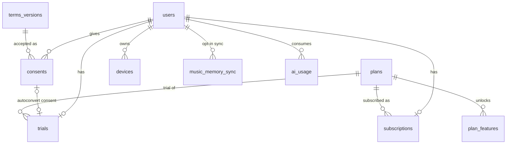

# COSOUND – Database structure (deliverable 5)

Version 0.3 · 2026-11-24 · Two databases by design (local-first):

| Store | Engine | Holds | Never holds |
|---|---|---|---|
| **Cloud DB** | Supabase Postgres + RLS (existing) | accounts, plans, subscriptions, entitlements, devices, releases, consents, optional memory sync, AI usage | user's audio, library index, plugin list, projects |
| **Local DB** | SQLite (one file per OS user, in the app data dir) + FTS5 + sqlite-vec | studio data: library, plugins, projects, op log, sessions, memory master, jobs | payment data, other users' data |

Files (audio, MIDI, stems, renders, backups) stay on disk; the DB stores paths + hashes.

## 1. Cloud DB (Supabase)

### 1.1 Existing (Prompt 01, unchanged)
`admins`, `profiles`, `plans` (base/pro/premium, prices, Stripe price IDs), `subscriptions`
(status trialing/active/past_due/canceled), `daws`, `releases` (+ private `releases` bucket),
`devices`, `announcements`. Function `has_download_access()`.

### 1.2 New (to add in the implementation phase – migrations not written yet)

| Table | Columns (main) | RLS |
|---|---|---|
| `plan_features` | `plan_code → plans`, `feature_key text`, `limits jsonb` (e.g. AI requests/month), PK(plan_code, feature_key) | public read, admin write |
| `app_settings` | `key text pk`, `value jsonb` (e.g. `trial_days: 7`, `entitlement_grace_hours`) | public read of non-secret keys, admin write |
| `terms_versions` | `id`, `kind` (subscription/privacy/eula), `version`, `published_at`, `url` | public read, admin write |
| `consents` | `user_id`, `terms_version_id`, `accepted_at`, `context` (trial_autoconvert, privacy…), `ip_hash` | insert/read own, admin read; never updated (append-only) |
| `trials` | `user_id pk`, `plan_code`, `started_at`, `ends_at`, `autoconvert_consent_id → consents` (nullable), `converted_at` | read own, write by Edge Function (service role) |
| `music_memory_sync` | `user_id`, `fact_id`, `payload jsonb` (encrypted client-side ⏳), `updated_at`, `deleted` | own rows only |
| `ai_usage` | `user_id`, `period`, `feature_key`, `requests`, `tokens_in`, `tokens_out` | read own, write by gateway |
| `device_registrations` (or extend `devices`) | device public key, app version, OS version | own read; insert via Edge Function |

Rules: entitlement checks happen **server-side** in Edge Functions (`entitlements`, `ai-gateway`);
the desktop only caches a signed token. `subscriptions`/`trials` are written only by service role
(admin UI or future Stripe webhook), never by the client.

## 2. Local DB (SQLite)

Owner: Rust Core (single writer). The Python Engine never opens the DB; it receives inputs and
returns results through JSON-RPC. Migrations versioned in `desktop/src-tauri/migrations/`.

Each domain's tables are **owned by its spec** (full columns there); this section is the
canonical list. Shared tables are defined here.

### 2.1 Smart Library – owner `specs/SMART-LIBRARY.md` §5
| Table | Main columns |
|---|---|
| `volumes` | `id`, `kind` (internal/external/usb/network), `fingerprint_json` (macOS volume UUID / Windows volume GUID + serial), `label`, `fs_type`, `online`, `last_seen_at` |
| `library_roots` | `id`, `volume_id`, `rel_path`, `bookmark_blob` (macOS security-scoped), `watch_mode` (events/poll/manual), `scan_state`, `last_scan_at` |
| `files` | `id`, `volume_id`, `root_id`, `rel_path` (unique per volume), `kind`, `size`, `mtime`, `quick_hash`, `full_hash`, audio metadata (duration, sample rate, channels, bit depth), `bpm`/`bpm_src`/`bpm_conf`, `musical_key`/`key_src`/`key_conf`, `is_loop`, `missing_since` |
| `file_tags` | `file_id`, `tag`, `source` (user/filename/embedded/model), `confidence` |
| `files_fts` | FTS5 over names, path tokens, tags |
| `file_vec` | sqlite-vec: `file_id` → CLAP embedding (+ model id/version) |
| `scan_jobs` | per-root scan statistics (linked to `jobs`) |

Duplicates are found by `full_hash` (no separate table).

### 2.2 Audio, Stems, Voice, Reference – owners `specs/AUDIO-STEMS.md`, `VOICE-TO-MUSIC.md`, `REFERENCE-TRACK.md`
| Table | Main columns |
|---|---|
| `audio_assets` | `id`, `project_id`, source (path or `file_id`), `provenance` (own/daw_export/suno/udio/other_ai/unknown), `full_hash` |
| `analyses` | `id`, `asset_id`, `kind` (loudness/tempo/key/chords/structure/descriptors), `result_json`, `confidence`, `measured`, `engine_versions_json` |
| `stems` | `id`, `asset_id`, `origin` (provided/separated), `role`, `decision` (audio/midi/replace), `decision_conf`, artifact refs |
| `voice_takes` | `id`, `project_id`, `mode` (describe/melody/bass/beatbox/tap), audio artifact, `click_bpm` |
| `voice_results` | `id`, `take_id`, `kind` (transcript/notes/drums/tempo), `payload_json`, confidences, `confirmed_at`, MIDI artifact |
| `beatbox_calibration` | per-user samples/features per drum class |
| `reference_tracks` | `id`, title, artist, `mbid`, `isrc`, optional user file + hash |
| `reference_web_facts` | field, value, source URL, retrieved_at (basis = web) |
| `reference_features` | feature, value, confidence, engine version (basis = audio) |
| `reference_profiles` | `profile_json`, `basis` (web/audio/both), project |
| `web_cache` | fetched public pages/API responses with expiry |

### 2.3 Plugin Intelligence – owner `specs/PLUGIN-INTELLIGENCE.md` §9
| Table | Main columns |
|---|---|
| `plugins` | `id`, `uid` (VST3 class ID / AU type-subtype-manufacturer / CLAP id), name, vendor, kind (instrument/effect) |
| `plugin_versions` | `plugin_id`, `format`, `version`, `path`, `platform`, `moduleinfo_json`, `scanned_at` |
| `plugin_presets` | `plugin_id`, name, path, format, source (factory/user/cosound), tags, hash, `volume_id` |
| `plugin_param_maps` | host parameters per plugin version and DAW |
| `plugin_semantic_maps` | normalized synth model (e.g. `filter1.cutoff`) → route (host param / hand) + transform |
| `plugin_gui_maps` | GUI layout for the human hand per plugin version, scale factor and window size |
| `plugin_control_levels` | per plugin version × DAW: host_params / hand / none, measured_at |

### 2.3b DAW, projects, operations, safety – owner `specs/DAW-CONTROLLER.md` §10 + this file
| Table | Main columns |
|---|---|
| `daw_installations` | `daw`, `version`, `path`, `platform`, `detected_at` |
| `daw_connectors` | `daw`, connector/bridge version, tested DAW version, capabilities, status, last health |
| `projects` | `id`, `name`, `daw`, `daw_project_path`, `workspace_path`, `bpm`, `key`, `created_at` |
| `project_context` | `project_id`, `revision`, `state jsonb` (sections, tracks, parts, decisions) |
| `artifacts` | `id`, `project_id`, `kind` (midi/audio/stem/render/analysis), `path`, `sha256`, `produced_by` (sub-agent), `trace_id`, `created_at` |
| `op_log` | `id`, `trace_id`, `project_id`, `session_id`, `task_id`, `op`, `risk`, `route` (api/protocol/hand/file), `request_json`, `state` (AIL §5), `approved_by`, `before_json`, `after_json`, `undo_kind`, `error`, timestamps |
| `op_backups` | `id`, `project_id`, `op_log_id`, `method`, `path`, `created_at` |

### 2.4 Sessions, AIL, jobs
| Table | Main columns |
|---|---|
| `sessions` | `id`, `project_id`, `agent_port` (temp/real), `started_at` |
| `messages` | `id`, `session_id`, `role` (user/assistant/system), `content`, `attachments jsonb`, `created_at` |
| `ail_tasks` | `task_id`, `trace_id`, `session_id`, `capability`, `request jsonb`, `status`, `result jsonb`, `error`, timestamps |
| `jobs` | `id`, `task_id`, `capability`, `progress`, `state`, `pid`, `error`, `started_at`, `finished_at` |

### 2.5 Music Memory & settings
| Table | Main columns |
|---|---|
| `memory_facts` | `id`, `category` (genre/bpm/library/plugin/style/mix/habit/assistant), `key`, `value jsonb`, `origin` (explicit/learned), `confidence`, `source_ref`, `updated_at`, `sync` (bool) |
| `settings` | `key`, `value jsonb` (e.g. `assistant_name`, language, permissions granted) |

`assistant_name` is a memory fact (category `assistant`) mirrored in `settings` for the UI.

## 3. Rules
- Paths stored **relative to volume + root**, so a drive that changes letter/mount point is re-matched by volume ID.
- Every analyzed value carries a `*_basis` or `analyzer_version`: COSOUND never shows estimates as measurements.
- Local DB is never uploaded. Only `memory_facts` with `sync=true` go to `music_memory_sync`, after opt-in.
- Deleting the account deletes cloud rows (`on delete cascade`, existing pattern); the app offers "wipe local data".

Tables required by the specs in `specs/` are reconciled in §4.

## 4. Reconciliation with specs (done 2026-11-24)
- Domain tables follow the specs; shared tables (`projects`, `project_context`, `artifacts`, `op_log`, `jobs`, `sessions`, `messages`, `ail_tasks`, `memory_facts`, `settings`) are defined here.
- Canonical names: Smart Library files are `files` (not `library_files`); artifacts use `sha256` and `produced_by`; long jobs use the shared `jobs` table.
