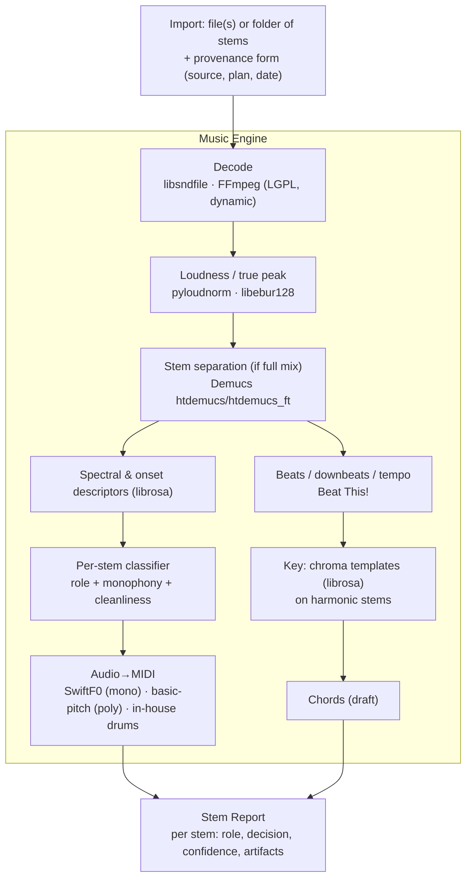

# Spec – Audio Analysis and Stems (Prompt 03 §7, deliverable 10)

Version 0.1 · 2026-11-24 · Status: PROVISIONAL (design; nothing implemented).
Knowledge: `docs/knowledge/audio-stem-analysis/` (*KB §n*), `docs/knowledge/audio-engineering/`
(measurement rules), `docs/knowledge/voice-to-music/` §3–4 (pitch/notes).

## 1. Purpose and owner
Import and analyze audio the user brings – full mixes, stems, loops, recordings, exports from other
DAWs, songs from Suno/Udio/other AI generators – and decide, part by part, what stays audio, what is
rebuilt as MIDI, and what is replaced with the user's own sounds. Results feed arrangement, sound
replacement and DAW import.
- **Sub-agent owner:** Audio Analysis Agent. It also provides measurements to Mixing/Mastering
  Engineers and audio analysis to the Reference Track Agent.
- **Code:** Music Engine `engine/cosound_engine/analysis/` and `stems/`; jobs managed by Core (`bus/` job manager).

## 2. Scope
In scope: decode WAV/AIFF/MP3/FLAC (+ other FFmpeg-LGPL formats), loudness/true peak, tempo/beats/
downbeats, key, chord draft, spectral/transient descriptors, structure sections, stem separation of
full mixes, per-stem classification and the **audio / MIDI / replace** decision, audio→MIDI for
eligible stems, import of AI-generated material with provenance.

Out of scope: judging the mix (Mixing Engineer), choosing replacement sounds (Smart Library + Sound
Designer), writing into the DAW (DAW Controller), training any model on user files (forbidden for
Suno output by Suno's terms, KB §7, and not done for any user file).

## 3. Components

## 4. Pipeline
1. **Import + provenance.** User drops files or a stems folder. COSOUND asks the source (own
   recording / other DAW / Suno / Udio / other AI / unknown) and, for AI tools, the plan, and stores
   it. For Suno: reminder that commercial use depends on a paid plan and remixes are non-commercial;
   for Udio: downloads have been disabled since the UMG deal (current status to verify) – KB §7.
   Not legal advice; the user is responsible for rights.
2. **Decode** to float at original rate; files stay where they are, analysis artifacts go to the
   project workspace (KB §1).
3. **Measure** integrated/short-term loudness, LRA, true peak, peak, clipping – flagged `measured:true`
   (audio-engineering measurement rules).
4. **Separate** only if the input is a full mix (or a stem with obvious bleed): Demucs 4-stem
   (drums/bass/vocals/other) as license-clean default; RoFormer models only after each checkpoint's
   license is cleared (KB §2). Separation is a long job with progress and cancel.
5. **Rhythm:** Beat This! beats/downbeats → tempo (and tempo changes), bar grid (KB §3).
6. **Harmony:** key by chroma template matching on harmonic stems (no drums); chords as a draft
   constrained to the key (KB §4–5). Both with confidence and user override.
7. **Structure:** section boundaries (intro/break/build/drop…) from energy, novelty and stem
   activity per bar – ⏳ method decided in implementation (KB has no validated permissive tool for
   EDM sections; see reference-track KB).
8. **Per-stem classification** → role (kick, drums, bass, lead, pad, vocal, FX…), monophony,
   cleanliness (bleed estimate) → decision from §5 table.
9. **Rebuild** eligible stems: monophonic → SwiftF0 → notes; clean single polyphonic instrument →
   basic-pitch draft; drums → kick/snare/hat pattern via onset + classifier (in-house; ADTOF/madmom
   models are non-commercial) – KB §8.
10. **Report** to the Agent: Stem Report with every value's confidence and `measured` flag, plus
    proposed operations (import stem as audio track, insert rebuilt MIDI, replace kick with library
    sample X) – executed only through the Safety Gate.

## 5. Decision table – edit as audio / rebuild as MIDI / replace with the user's sounds
Based on KB §8; "replace" means: keep the musical content, swap the sound with the user's samples or
instruments.

| Stem content | Edit as audio | Rebuild as MIDI | Replace with user's sounds |
|---|---|---|---|
| Clean monophonic line (bass, lead synth, whistle, solo melody) | yes (gain, EQ, warp, chop) | **yes, high confidence** (SwiftF0 / basic-pitch) | **yes**: MIDI → user's synth (Sound Designer) |
| Single polyphonic instrument, clean (piano, guitar chords) | yes | partial: **draft**, user cleans up | yes, after MIDI cleanup |
| Drums (separated) | yes (slice, re-sequence) | kick/snare/hat pattern **yes**; ghosts, toms, cymbal detail weaker | **yes**: pattern → user's drum samples (Smart Library) |
| Dense pads / stacked synths / reverb tails | **yes – keep audio** | no; chords/key as metadata only | partial: new pad played on the extracted chords |
| Lead or mixed vocals with lyrics | **yes – keep audio** | melody only as a guide MIDI | no (COSOUND does not synthesize voices) |
| FX, risers, impacts, foley, textures | **yes – audio only** | no | yes: similar FX from the library (similarity search) |
| Heavily processed / distorted / bent leads | yes | usually no (unstable pitch) | partial: approximate with user's synth, flagged |
| Stems with strong separation artifacts | yes, with warning | lower confidence on everything | prefer replacement over reuse |

Rule: MIDI only when the part is monophonic or sparsely polyphonic, pitched and clean; otherwise
audio plus descriptive metadata (KB §8).

## 6. Tables used (local SQLite – to reconcile with `DATABASE.md`)
- `audio_assets(id, project_id, source_path_or_file_id, provenance[own|daw_export|suno|udio|other_ai|unknown], provenance_plan, imported_at, full_hash)`
- `analyses(id, asset_id, kind[loudness|tempo|key|chords|structure|descriptors], result_json, confidence, measured, engine_versions_json, created_at)`
- `stems(id, asset_id, origin[provided|separated], separator_model, role, monophony, bleed_score, decision[audio|midi|replace], decision_conf, audio_artifact_id, midi_artifact_id)`
- Shared: `artifacts` (owned by DATABASE.md), `jobs(id, capability, state, progress, started_at, finished_at, error)` (bus job manager).

## 7. Capabilities on the bus

| Capability | Input | Output | Risk | Long job? |
|---|---|---|---|---|
| `audio.import` | paths or library file_ids, provenance | asset ids | low (workspace refs only) | no |
| `audio.measure_loudness` | asset_id | integrated/short-term/LRA/true peak/clipping, `measured:true` | read | short |
| `audio.analyze` | asset_id, what[] (tempo, key, chords, structure, descriptors) | analyses with confidence | read | **yes** |
| `stems.separate` | asset_id, model (default htdemucs) | stem ids + audio artifacts | read (new files in workspace only) | **yes** |
| `stems.classify` | stem_ids | role, monophony, bleed, decision + reason | read | short |
| `stems.to_midi` | stem_id, options (quantize, key snap) | midi artifact draft + confidence | read | yes |
| `stems.report` | asset_id | Stem Report (all of the above) | read | no |

All are read-only toward user files; any DAW change goes through proposed ops.

## 8. OS permissions
Read access to user-chosen files (picker/drag-and-drop = implied consent on macOS; removable/network
volume prompts as in Smart Library). No mic, no network (models bundled or downloaded once ⏳).

## 9. Performance targets (targets, not measurements)
- Loudness + tempo + key for a 6-min track: < 30 s on a recent laptop CPU.
- Demucs separation of a 6-min track: minutes on CPU; faster with GPU/MPS – shown with progress
  and ETA, never blocking chat.
- Results cached by `full_hash` + engine version: re-opening the same file costs nothing.

## 10. Failure modes and honest reporting
- Each value has confidence; anything not computed is absent or `measured:false` – never estimated
  from text.
- Key/chords: ambiguity (relative major/minor, modal) reported, not hidden.
- Separation quality low (high bleed) → decision downgraded and stated.
- Unsupported codec → clear error naming the format.
- Job cancelled/crashed → `status:error` with cause; partial results kept and labelled.

## 11. Limitations
- No maintained, permissively licensed chord or drum-transcription model verified → in-house work
  (KB limitations). Essentia (AGPL), madmom/ADTOF models (non-commercial), Chordino (GPL) excluded.
- Demucs upstream archived; fork "not actively developed" (KB §2).
- RoFormer checkpoint licenses unverified.
- pyloudnorm/libebur128 implement BS.1770-4; BS.1770-5 differences to verify.
- Suno/Udio features and terms change often – re-check before release.

## 12. Acceptance tests (first implementation)
1. A 120 BPM 4/4 test track with known key → tempo 120 ± 0.5, correct downbeats on ≥ 95% of bars
   (target), key correct or relative major/minor flagged.
2. Loudness of EBU test signals matches the reference values within ±0.1 LU (pyloudnorm/libebur128).
3. Full mix → 4 stems written to the workspace; original file unchanged (hash identical).
4. Clean monophonic bass stem → MIDI decision "midi" with notes matching the source MIDI ≥ 90% (target).
5. Pad stem → decision "audio" + chords metadata; FX stem → "audio".
6. Suno import → provenance stored; reminder shown; no data sent over the network.
7. Same file analyzed twice → second run served from cache.
