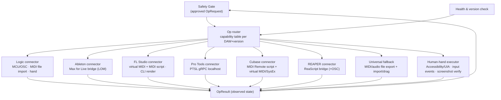

# Spec – DAW Controller (Prompt 03 §10, deliverable 13)

Status: v0.1 · 2026-11-24 · PROVISIONAL. Every capability below comes from
`docs/knowledge/daw-integration/README.md` and the six DAW folders (versions verified 2026-11-24:
Logic 13.0, Live 12.4.16, FL Studio 2026.1.7, Pro Tools 2026.11, Cubase 15.0.40, REAPER 7.86).
Nothing here adds DAW features beyond the KB. Architecture: `../ARCHITECTURE.md`,
`../MULTI-AGENT-ARCHITECTURE.md` §6 (safety), §7b (human hand).

## 1. Purpose and owner
The **only** component of COSOUND that touches a DAW. Translates abstract operations
(`insert_midi_clip`, `set_tempo`…) into the route each DAW actually supports and reports the
**exact** outcome.
- **Owner:** DAW Controller Agent (sub-agent 12). Makes no musical decisions.
- Receives ops only from the Safety Gate (after central-Agent approval), never from other agents.

## 2. Scope / out of scope
In: one connector per DAW, the universal file fallback, the human-hand executor, health checks,
version pinning, undo/backup support, project-state reading.
Out: deciding what to create (Producer/Theory/Rhythm/Sound Designer), plugin inventory (Plugin
Intelligence), approvals (central Agent + Safety Gate).

## 3. Components

In-DAW code lives in `connectors/<daw>/` (see `../ARCHITECTURE.md` §12); the Rust side in
`desktop/src-tauri/src/daw/`.

## 4. Common connector interface
Every connector implements the same interface; unsupported ops return `unsupported`, never a fake success.
```
detect() -> {installed, version, running, project_open}
health() -> {route_ok, bridge_version, permissions_missing[]}
capabilities(version) -> {op -> class: official|protocol|hand|fallback|none}
read_state() -> ProjectState (tracks, tempo, sections/markers, devices…) | partial | unsupported
execute(op) -> OpResult {status: ok|partial|failed|unsupported, observed, undo_token?}
backup() -> {method, path}            # "save as versioned copy" route per DAW
undo(undo_token) -> OpResult
```
Op set (v1): `create_track`, `insert_midi_clip`, `import_audio`, `set_tempo`, `set_key`,
`transport` (play/stop/locate), `set_mixer` (volume/pan/mute), `insert_plugin`, `set_plugin_param`,
`write_automation`, `load_preset`, `export`, `read_state`.

## 5. Operation routes per DAW (from KB matrix)
Priority order (Prompt 03 §10): Logic, Ableton, FL, Pro Tools, then Cubase, REAPER.
**REAPER is built first as the end-to-end test bed** (every op is `official` via ReaScript), without
changing the product priority.

| Op | Logic 13 | Ableton 12.4 | FL 2026.1 | Pro Tools 2026.11 | Cubase 15 | REAPER 7.86 |
|---|---|---|---|---|---|---|
| create_track | hand | official (LOM) | hand | official (PTSL) | protocol (key command; name to verify) | official |
| insert_midi_clip | protocol (MIDI file import) | official | official-limited (piano-roll script/step seq) | hand (MIDI import UI) | protocol (MIDI file / DAWproject) | official |
| import_audio | hand | official | hand | official | hand | official |
| set_tempo | hand | official | official | hand | protocol | official |
| set_key | hand | official | none | hand | to verify | to verify |
| transport | protocol (MCU/HUI/OSC) | official | official | official | protocol | official |
| set_mixer | protocol | official | official | official (via automation breakpoints) | protocol | official |
| insert_plugin | hand | official (native devices) / hand (third-party) | hand | hand | protocol (DirectAccess) | official |
| set_plugin_param | protocol | official (exposed params) | official | official (breakpoints) | protocol | official |
| write_automation | protocol (move control in Latch/Touch) | to verify | to verify | official | protocol | official |
| load_preset | hand | official (plugin programs) / hand | official (next/prev) / hand | hand | to verify | official |
| export | hand | hand | official (offline CLI, saved project) | official | hand | official (render action ID to verify) |
| read_state | to verify (surface feedback) | official | partial | official | protocol | official |
`hand` = KB class `ui-automation`, executed by the human-hand executor. `to verify` ops are disabled
until verified on a real machine and the KB updated.

### Per-DAW notes (prerequisites)
- **Logic:** no public API; control surface/OSC is bank-relative (8-channel pages), so the connector
  tracks banks. Needs Accessibility (+ Screen Recording for hand). Re-verify on every Logic release.
- **Ableton:** requires Max for Live (Suite or add-on); without it Live falls back to hand + files.
  Remote Script route undocumented → not used in v1.
- **FL Studio:** MIDI script inside FL reacts only to MIDI → COSOUND sends a custom SysEx/CC protocol
  over a virtual port; edition requirement for MIDI scripting to verify. CLI render works on a saved project only.
- **Pro Tools:** PTSL SDK behind an Avid account + licence (terms **not yet reviewed** → blocker for shipping).
  AAX-only: user's VST/AU instruments are not available there.
- **Cubase:** COSOUND MIDI Remote script + virtual MIDI ports with SysEx framing; DirectAccess needs API 1.3 (15.0.20+).
- **REAPER:** ReaScript bridge (bridge pattern to verify: deferred script polling vs OSC action vs
  C++ extension). Python ReaScript needs user Python → use Lua.

### Virtual MIDI ports
macOS: CoreMIDI virtual ports from COSOUND. Windows: no built-in virtual ports in the classic MIDI API
→ ⏳ decision (Windows MIDI Services loopback endpoints vs third-party driver) – see `../DECISIONS.md` / risks.

## 6. Universal fallback (works in every DAW)
COSOUND writes a Standard MIDI File (tempo + time-signature meta events, track names) or renders/locates
audio in the project workspace, then either (a) the connector imports it where the route exists, (b) the
hand drags/imports it, or (c) the UI shows a draggable card and the user drops it. Always available;
the baseline for the first release.

## 7. Human-hand executor
Implements MULTI-AGENT-ARCHITECTURE §7b for DAW UI and plugin GUIs:
1. Focus the target window (DAW / plugin).
2. Locate target: Accessibility/UI Automation tree for DAW menus and dialogs; vision + GUI map
   (from Plugin Intelligence) for custom-drawn plugin GUIs.
3. Act with real input events (click, drag, type, key command).
4. **Verify**: re-read AX value / screenshot / host-parameter echo. No verification → `failed`.
5. Overlay "COSOUND is operating" + global stop key; user input during an op aborts it safely.
Automation via hand: set the DAW to Latch/Touch record, move the control along the curve, stop.

## 8. Safety Gate integration and undo
Risk levels (read/low/medium/high) per MULTI-AGENT-ARCHITECTURE §6. The Controller adds:
- **Before medium/high:** `backup()` – save-as versioned copy of the project via the DAW route or hand
  (Save As dialog); backup path recorded in `op_backups`. If backup fails, the op is refused.
- **Undo strategy, in order:**
  1. inverse op from the op log (e.g. restore previous fader value, delete the clip we created) when the route can read and write that state;
  2. DAW native undo triggered through its route (FL scripts expose undo points per KB; other DAWs via key command = hand, to verify per DAW);
  3. restore the backup copy (user confirmation).
  The OpResult states which level is available (`undo: inverse|native|backup|none`).
- Every op logged in `op_log` with request, route used, before/after observed values, result.

## 9. Health checks and version pinning
- On start and every DAW switch: `detect()` + `health()`; missing permissions surfaced in the DAWs panel.
- `daw_connectors` stores the DAW version tested for each capability; an unknown newer version runs in
  **guarded mode**: read-only + fallback until a self-test passes (create temp track → insert clip →
  read back → undo, in a scratch project).
- In-DAW scripts carry a `bridge_version`; mismatch → reinstall prompt.

## 10. Tables used (local SQLite – reconcile with `../DATABASE.md`)
| Table | Key columns |
|---|---|
| `daw_installations` | id, daw, version, path, platform, detected_at |
| `daw_connectors` | daw, connector_version, bridge_version, tested_daw_version, capabilities_json, status, last_health_json |
| `op_log` (shared with Safety Gate) | id, project_id, session_id, task_id, op, risk, route, request_json, before_json, after_json, status, undo_kind, created_at |
| `op_backups` | id, project_id, op_log_id, method, path, created_at |
| `projects` (shared) | id, daw, daw_project_path, workspace_path |
Reads `plugin_gui_maps` / `plugin_semantic_maps` from Plugin Intelligence for hand ops.

## 11. Capabilities on the bus
| Capability | Input | Output | Risk | Long job? |
|---|---|---|---|---|
| `daw.detect` | – | installed DAWs, versions, running | read | no |
| `daw.health` | daw | route status, missing permissions | read | no |
| `daw.read_state` | daw | ProjectState / partial | read | no |
| `daw.create_track` | type, name, position | track ref | low | no |
| `daw.insert_midi_clip` | track, bar, `artifact://` SMF | clip ref | low | no |
| `daw.import_audio` | track, position, file ref | clip ref | low | no |
| `daw.set_tempo` / `daw.set_key` | value | observed value | low (empty project) / medium (existing) | no |
| `daw.transport` | play/stop/locate | state | read | no |
| `daw.set_mixer` | track, volume/pan/mute | observed | medium | no |
| `daw.insert_plugin` | track, plugin uid, slot | slot ref | low (new slot) / high (replace) | no |
| `daw.set_plugin_param` | track, slot, resolved target, value | observed | medium | no |
| `daw.write_automation` | lane, points | observed points | low (new lane) / medium | no |
| `daw.load_preset` | track, slot, preset ref | observed name | medium | no |
| `daw.export` | range, format, path | file ref | low (new file) / high (overwrite) | yes |
| `daw.backup` | project | backup path | low | no |
| `daw.undo` | op_log_id | OpResult | medium | no |
Risk "low" vs "medium/high" decided by the Safety Gate from the op and the observed project state.

## 12. OS permissions
macOS: Accessibility (hand, Logic), Screen Recording (plugin GUI hand), Automation/Apple Events (if
AppleScript menus are used), Local Network (OSC on localhost – to verify whether loopback needs it).
Windows: UI Automation + SendInput (an elevated DAW needs COSOUND elevated), firewall prompt for local
OSC/gRPC (to verify). Requested just-in-time from the DAWs panel.

## 13. Failure modes
| Failure | Behaviour |
|---|---|
| DAW not running / no project open | `status:needs_input`, ask user |
| Route down (bridge not loaded, PTSL not answering) | health → fallback route, explicit to user |
| Op unsupported on this DAW/version | `unsupported` + suggested fallback; never simulated |
| Hand verification fails | `failed` with screenshot-free description; no blind retries |
| User touches mouse/keyboard mid-op | abort, report partial state, offer undo |
| Backup fails before risky op | op refused |
| DAW updated to untested version | guarded mode (§9) |

## 14. Limitations
- Logic (priority 1) is the hardest: no API, bank-relative surfaces, hand needed for structure ops.
- Ableton full route needs Max for Live; third-party plugin insertion and export only via hand.
- FL cannot build arrangements from scripts; Pro Tools lacks MIDI/tempo/plugin-insert commands; PTSL licence unreviewed.
- Several cells are `to verify`; they stay disabled until checked on real machines (this Linux dev server can't run DAWs).
- Hand ops are slower and fragile to UI changes; every one is verified.

## 15. Acceptance tests (first implementation)
1. REAPER: full op set in a scratch project; `read_state` after each op matches the request.
2. REAPER: undo via inverse op restores the previous fader value and removes a created clip.
3. Universal fallback: generated SMF (tempo + time signature) imports into each available DAW with correct tempo and bar placement.
4. Unsupported op (e.g. `set_key` on FL) returns `unsupported`, never `ok`.
5. Medium/high op without a successful backup is refused.
6. Health check reports missing Accessibility permission on macOS and blocks hand ops.
7. Logic prototype: transport + fader via control surface/OSC, MIDI clip via file import, track creation via hand — each verified by read-back.
8. Unknown DAW version → guarded mode until self-test passes.
