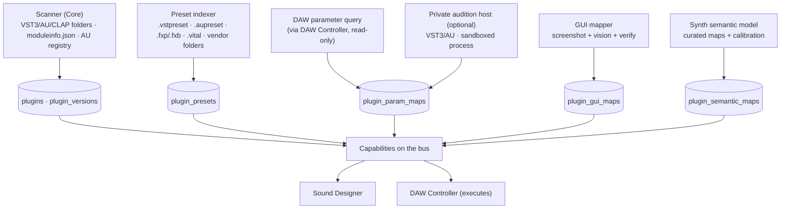

# Spec – Plugin Intelligence (Prompt 03 §9, deliverable 12)

Status: v0.1 · 2026-11-24 · design document.

> **Implemented on 2026-11-26 (Prompt 08)**: scanner, registry, knowledge engine, parameter discovery and control through
> COSOUND's isolated Audio Unit host, presets, sound design with before/after audition, effect chains, DAW adapter.
> Hosting is Audio Units on macOS only. Control inside DAWs and the human hand are not built. Current architecture:
> `docs/plugin-intelligence/ARCHITECTURE.md`; report: `docs/plugin-intelligence/PROMPT-08-REPORT.md`.
>
> The rest of this document is the original design. Knowledge base: `docs/knowledge/integration-sdks/`,
`synthesizers/`, `plugins-effects/`, `daw-integration/`. Architecture: `../ARCHITECTURE.md`,
`../MULTI-AGENT-ARCHITECTURE.md` §7b (human-hand principle).

## 1. Purpose and owner
Know **what instruments and effects the user has**, **how each one can be controlled**, and give the
other agents a uniform way to say "cutoff 30 % lower, slower attack" regardless of the plugin.

- **Owner:** Plugin Intelligence Agent (sub-agent 9): inventory, maps, control levels.
- **Uses it:** Sound Designer (3) decides *what* to set; Mixing/Mastering pick effects.
- **Executes:** only the DAW Controller (12) changes a plugin inside a DAW session, through the
  Safety Gate. Plugin Intelligence never moves the hand itself.

## 2. Scope / out of scope
In: plugin & preset inventory, format/host compatibility, parameter maps, GUI maps for the human
hand, the synth semantic model, preset indexing, Vital preset read/write.
Out: choosing sounds (Sound Designer), executing DAW operations (DAW Controller), reverse-engineering
closed preset formats, hosting AAX, distributing VST2 code.

## 3. Realistic format support (from KB)
| Format | Scan without loading | Parameters known via | COSOUND hosts it? | Notes |
|---|---|---|---|---|
| VST3 | yes – fixed folders + `moduleinfo.json` | DAW API, or own host (normalized 0–1, stable IDs) | yes (MIT SDK) | main cross-platform target |
| AU v2/v3 (macOS) | yes – Components folders, `AVAudioUnitComponentManager` | DAW API (Logic: limited), or own host (`parameterTree`) | yes | only format in Logic |
| VST2 | folder scan, name/vendor only | DAW API only | **no** (licence) | legacy; Cubase 15 disables by default (to verify) |
| AAX | presence in Avid folders only (to verify paths) | Pro Tools route only (PTSL automation breakpoints) | **no** | Pro Tools-only |
| CLAP | yes – fixed folders + `CLAP_PATH` | DAW API (REAPER, FL) | not in v1 (no JUCE support) | later |

## 4. Control level per plugin (per DAW)
Every (plugin, DAW) pair gets a measured **control level**, never assumed:
| Level | Meaning | How set |
|---|---|---|
| `host_params` | the parameters we need are exposed by the DAW route | enumerated via DAW API (REAPER/Live/FL/Cubase/PT) |
| `host_partial` | only some (e.g. Massive XL Macros + Morpher; Live's 64 auto-exposed) | enumerated + compared with the semantic needs |
| `hand` | GUI operation required (closed params, plugin preset browser, Logic) | GUI map exists and passed verification |
| `file_only` | preset file editable directly (Vital `.vital` JSON) | format check |
| `none` | not reachable (e.g. AAX outside Pro Tools, plugin fails to open) | — |
A plugin can combine levels (e.g. `host_partial` + `hand`). Levels are stored per plugin **version**.

## 5. Components

Private audition host: a **separate, crash-isolated process** using the VST3 SDK (MIT) and AU APIs
directly. JUCE (AGPL/commercial) and pedalboard (GPLv3) are **not** linked into the product unless a
licence decision says so (`../DECISIONS.md`). Copy-protected plugins may refuse to run outside a DAW
(to verify per vendor) → then only DAW routes apply.

## 6. Synth semantic model
A normalized vocabulary the agents use; each plugin maps onto it.
```
oscillator[n]: waveform | wavetable_position | octave | semitone | fine | level | unison_voices | detune
filter[n]: type (LP/BP/HP/notch) | slope_db | cutoff | resonance | drive | key_tracking | env_amount
envelope[amp|filter|modN]: attack | decay | sustain | release
lfo[n]: shape | rate (Hz or sync) | depth | destination
mod_matrix: [source -> destination, amount]
fx: distortion | chorus | delay | reverb (mix, time, feedback…)
global: volume | glide | voices | macro[n]
```
- **Mapping record** (`plugin_semantic_maps`): semantic path → route (`host_param_id` | `gui_control_id`
  | `json_path` for Vital) + value transform.
- **Value transforms:** host values are normalized 0–1. Physical units (Hz, ms, dB) come from the
  plugin's own display string when the route provides it; otherwise from a **calibration sweep**
  (set N values, read display/GUI text, fit curve). No unit is assumed.
- **Sources of maps, in order:** DAW-reported parameter names → curated maps for priority synths
  (Massive, Massive XL, Predator, Albino, Serum 2, Vital, Sylenth1, DAW stock instruments) →
  GUI mapping. Curated maps state their plugin version.
- Recipes in KB `synthesizers/` (sub bass, supersaw, pluck, pad, acid) are written in this
  vocabulary so they run on any mapped synth.

## 7. Human hand: GUI maps (MULTI-AGENT-ARCHITECTURE §7b)
- Built the first time a plugin is used with `hand` level: DAW Controller opens the plugin window →
  screenshot → vision model proposes controls (bbox, kind: knob/slider/button/menu/display, label)
  → a **verification pass** nudges each control and reads back (screenshot diff / value display /
  host parameter echo) → only verified controls are stored.
- Keyed by plugin version + window size/scale factor; invalidated on plugin update or failed verify.
- Stores no screenshots after mapping (privacy), only geometry and labels.

## 8. Presets
| Kind | Action |
|---|---|
| `.vstpreset`, `.aupreset`, `.fxp/.fxb`, vendor folders | index (name, plugin, path, tags from folder names); **load** through the DAW route or hand; never edit inner chunk |
| Vital `.vital` | read and write JSON directly (new presets saved as new files, never overwrite originals) |
| Serum, Massive/XL, Predator, Albino, Sylenth1 | index/organize only; sound changes via host params or hand on the live instance |
| User-made patches by COSOUND | saved by the plugin itself (hand: plugin's Save) or as `.vstpreset` from the audition host, into the user preset folder, with a `cosound_` prefix |

## 9. Tables used (local SQLite – reconcile with `../DATABASE.md`)
| Table | Key columns |
|---|---|
| `plugins` | id, uid (VST3 class ID / AU type-subtype-manufacturer / CLAP id), name, vendor, kind (instrument/effect), formats_json |
| `plugin_versions` | id, plugin_id, format, version, path, platform, scanned_at, moduleinfo_json |
| `plugin_presets` | id, plugin_id, name, path, format, source (factory/user/cosound), tags, file_hash, volume_id |
| `plugin_param_maps` | id, plugin_version_id, daw, param_id, name, units, steps, default, automatable, source (daw/host) |
| `plugin_semantic_maps` | id, plugin_version_id, semantic_path, route, target, transform_json, curated, verified_at |
| `plugin_gui_maps` | id, plugin_version_id, scale_factor, window_w, window_h, controls_json, verified_at |
| `plugin_control_levels` | plugin_version_id, daw, level_set, measured_at |
Shared: `jobs`, `volumes` (presets on external drives), `op_log` (via DAW Controller).

## 10. Capabilities on the bus
| Capability | Input | Output | Risk | Long job? |
|---|---|---|---|---|
| `plugins.scan` | roots (default std folders) | inventory diff | read | yes |
| `plugins.list` | filters (kind, format, daw) | plugins + control levels | read | no |
| `plugins.presets.search` | text, plugin, tags | presets | read | no |
| `plugins.params.discover` | plugin_version, daw | param map (via DAW Controller read) | read | no |
| `plugins.gui.map` | plugin_version, daw | verified GUI map | **low** (opens plugin window, no value kept) | yes |
| `plugins.semantic.resolve` | plugin_version, semantic changes | concrete ops (param id / gui control / json path + value) | read | no |
| `plugins.calibrate` | plugin_version, semantic path | transform curve | low | yes |
| `plugins.vital.write_preset` | patch spec | new `.vital` file ref | low (new file only) | no |
`semantic.resolve` returns `proposed_daw_ops`; the DAW Controller executes them after approval.

## 11. OS permissions
Read access to plugin and preset folders (standard locations; extra roots via picker). For `hand`:
macOS Accessibility + Screen Recording; Windows screen capture + SendInput (granted via DAW Controller).

## 12. Failure modes
| Failure | Behaviour |
|---|---|
| Plugin crashes in audition host | host process dies alone; plugin marked `audition_unsafe`; DAW routes only |
| Copy protection blocks audition | mark, continue with DAW routes |
| Param names generic ("Param 12") | semantic map falls back to calibration / hand; never guessed |
| GUI changed after update | verify fails → map invalidated → remap before acting |
| Value read-back mismatch | op reported failed with observed value; no retry loop without the central Agent |
| Preset file unreadable | indexed by name/path only |

## 13. Limitations
- Closed preset formats (Serum, NI, Rob Papen, inner `.fxp/.vstpreset` chunks): no file editing.
- Host exposure varies (Massive XL: Macros + Morpher documented; Live auto-exposes 64).
- Logic has no parameter-enumeration API → Logic relies on hand + Scripter/MIDI learn routes.
- AAX not hostable; VST2 not shippable; CLAP hosting deferred.
- Hand mode is slower and sensitive to scaling and GUI updates.

## 14. Acceptance tests (first implementation)
1. Scan of a test machine lists every VST3/AU/CLAP bundle in std folders without loading any plugin (process list shows no plugin load).
2. `moduleinfo.json` present → name/vendor/version/classes populated from it.
3. REAPER route: param map for Vital equals the list returned by `TrackFX_GetNumParams/GetParamName`.
4. Vital: read a factory preset JSON, change filter cutoff via semantic path, write a new file; Vital loads it and shows the new value.
5. Semantic resolve on a plugin with only macros returns `hand` routes for unmapped targets, never invented param IDs.
6. GUI map verification rejects a control whose nudge produces no visible/host change.
7. Re-scan after a plugin version bump invalidates its GUI and semantic maps.
