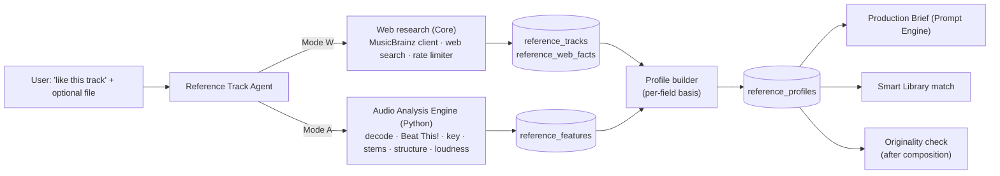

# Spec – Reference Track Analyzer (Prompt 03 §8, deliverable 11)

Status: v0.1 · 2026-11-24 · PROVISIONAL (capability names may be remapped by the AIL adapter when the
central Agent arrives). Knowledge base: `docs/knowledge/reference-track/`, `audio-stem-analysis/`,
`music-production/`. Architecture: `../ARCHITECTURE.md` §6, `../MULTI-AGENT-ARCHITECTURE.md` §3.

## 1. Purpose and owner
Turn "make something with the groove and energy of *this* song" into a **Reference Profile**: abstract,
non-copyable descriptors (tempo, feel, structure, energy shape, palette) that brief an **original**
track built with the user's own material.

- **Owner:** Reference Track Agent (sub-agent 7).
- **Delegates to:** Audio Analysis Agent (6) for every audio computation; Smart Library Agent (8) for
  matching the user's samples. The central Agent routes those calls (`needs`), not this agent.

## 2. The two modes – strictly separated
| | Mode W – Web Reference Research | Mode A – Audio Reference Analysis |
|---|---|---|
| Input | title / artist / link text / ISRC | an audio file the user supplies and lawfully has |
| Sources | MusicBrainz API, web search, Apple Music API metadata, Discogs (to verify) | local analysis only (Engine) |
| What it can say | identity, year, genre/style tags, credits, label, duration, published context | BPM, beats/downbeats, key, groove, structure, energy curve, bass/harmony/melody contours, timbre descriptors |
| What it can NEVER say | measured BPM/key/groove/energy "as heard" | — |

**Honesty rule (enforced in the contract, not in prose):** every field of every result carries
`basis: "web" | "audio" | "both"`, and the Profile carries a top-level `basis`. A field from the web
is phrased as "reported by <source>", never as heard. If no audio was analyzed, the Profile's
`basis` is `"web"` and the UI shows "Not listened – text sources only". Values from Mode W that
Mode A later measures are replaced and the discrepancy is shown.

Spotify audio-features/analysis are not used (restricted since 2024-11-27, policy forbids analysis);
AcousticBrainz data is frozen since 2022 → at most a labelled historic hint (`basis:"web"`,
`source:"acousticbrainz"`). See KB `reference-track/README.md`.

## 3. Components


## 4. Pipeline
1. **Identify** (Mode W): parse the request; query MusicBrainz (≤1 req/s, meaningful User-Agent —
   no user data in it); pick candidates; **ask the user to confirm** the right recording if >1.
2. **Web facts** (Mode W): genre/style tags, year, label, credits, duration; each stored with source
   URL and retrieval time. Web search results are hints, labelled with their source.
3. **Audio** (Mode A, only if the user supplies a file): Audio Analysis runs locally:
   tempo/beats/downbeats (Beat This!), key (chroma templates), stems (Demucs) → drum onsets per band,
   swing offset, bass contour (basic-pitch/F0), chord draft, melody contour (not notes), timbre
   descriptors, short-term loudness energy curve, segment boundaries (MSAF; all-in-one only if its
   weights licence is cleared), breakdown/build/drop heuristic (KB: **to verify on a test set**).
4. **Profile**: merge → Reference Profile (§6) with per-field `basis`, `confidence`, `source`.
5. **Brief**: Prompt Engine turns the Profile into a Production Brief for an original track
   (tempo range rather than exact copy, section map in bars, energy curve, palette adjectives,
   groove template).
6. **Library match**: Smart Library search by BPM range, key compatibility, category, timbre
   embedding similarity to Profile descriptors → candidate samples/presets **from the user's library**.
7. **Originality check** (after Music Theory/Producer generate material): compare generated melody
   and chord-plus-rhythm against the extracted reference contours; flag high similarity to the
   central Agent → regenerate or vary.

## 5. Legal and ethical guardrails (from KB, not legal advice)
- Never download, rip or record from streaming services (Spotify, YouTube…); only user-supplied files.
- The reference audio never enters the user's project, is never sampled, never uploaded, never used
  for training. Features stay local; the file path is stored, not a copy.
- Output is abstract; exact melodies, lyrics, hooks and chord-plus-rhythm combos are not transferred.
- UI reminder at Mode A start: "use files you own or are licensed to use".

## 6. Reference Profile (contract payload)
```json
{
  "profile_id": "uuid", "track": {"title": "…", "artist": "…", "mbid": "…", "basis": "web"},
  "basis": "both",
  "tempo": {"bpm": 126.0, "range": [124, 128], "basis": "audio", "confidence": 0.93},
  "meter": {"value": "4/4", "basis": "audio"},
  "key": {"value": "F minor", "alternatives": ["Ab major"], "basis": "audio", "confidence": 0.6},
  "groove": {"swing_pct": 54, "kick": "four-on-the-floor", "hat": "offbeat open", "basis": "audio"},
  "structure": [{"section": "intro", "bars": 16, "basis": "audio", "label_confidence": 0.5}],
  "energy_curve": {"resolution_s": 3, "values_lu": ["…"], "basis": "audio"},
  "palette": {"adjectives": ["bright", "wide", "short decay"], "basis": "audio"},
  "genre": {"tags": ["progressive house"], "basis": "web", "source": "musicbrainz"},
  "not_measured": ["harmony.exact_chords"],
  "sources": [{"kind": "web", "url": "https://musicbrainz.org/…", "retrieved": "2026-11-24T…"}]
}
```
`not_measured` lists what the user may expect but was not computed.

## 7. Tables used (local SQLite – reconcile with `../DATABASE.md`)
| Table | Key columns |
|---|---|
| `reference_tracks` | id, title, artist, mbid, isrc, user_file_path (nullable), file_hash, created_at |
| `reference_web_facts` | id, reference_track_id, field, value_json, source, url, retrieved_at |
| `reference_features` | id, reference_track_id, feature, value_json, confidence, engine_version, computed_at |
| `reference_profiles` | id, reference_track_id, project_id, profile_json, basis, created_at |
| `web_cache` (shared) | url_hash, url, status, body_hash, fetched_at, expires_at |
Reads: `files`, `files` (bpm/key columns) (Smart Library). Jobs via the shared `jobs` table.

## 8. Capabilities on the bus
| Capability | Input | Output | Risk | Long job? |
|---|---|---|---|---|
| `reference.identify` | free text / ISRC | candidate recordings (basis web) | read | no |
| `reference.research_web` | reference_track_id | web facts with sources | read (network) | no |
| `reference.analyze_audio` | reference_track_id + file ref | features (basis audio) | read | **yes** (stems: minutes) |
| `reference.build_profile` | reference_track_id | Reference Profile | read | no |
| `reference.brief` | profile_id + user intent | Production Brief draft | read | no |
| `reference.match_library` | profile_id, filters | ranked library items | read | no |
| `reference.check_originality` | profile_id + artifact refs (MIDI) | similarity scores, flags | read | no |
All read-only: this agent never proposes DAW ops directly.

## 9. OS permissions
- Network (outbound HTTPS) for Mode W; macOS Local Network not needed.
- File read for the supplied file (picker → security-scoped access on macOS).
- No microphone, no Accessibility.

## 10. Failure modes
| Failure | Behaviour |
|---|---|
| Track not found / ambiguous | return candidates, `status:needs_input` |
| MusicBrainz rate limit / offline | back off; Mode W partial; never fill with guesses |
| No file supplied | Profile `basis:"web"`, `not_measured` lists all audio fields; UI says "not listened" |
| Unsupported/corrupt file | `status:error` with decoder message |
| Low confidence key/structure | keep value with confidence + alternatives; Producer asks user |
| Separation artifacts | features from mix-level analysis only, flagged |
| Engine crash | job marked failed; Core restarts sidecar; result not fabricated |

## 11. Limitations
- No BPM/key from streaming APIs for new apps; Mode W is context only.
- Structure labels less reliable than boundaries; drop/build heuristic is EDM-centric and unvalidated.
- all-in-one weights licence and maintenance unclear → MSAF + own heuristic first.
- Analysis bounded by separation quality.
- Discogs terms not verified → disabled until checked.

## 12. Acceptance tests (first implementation)
1. Text-only request → Profile with `basis:"web"`, every audio field in `not_measured`, UI badge "not listened".
2. Request + user WAV of a steady 4/4 electronic track → BPM within ±1 of a hand-checked value, `basis:"both"`, tempo field `basis:"audio"`.
3. Web-reported BPM differs from measured → measured wins, discrepancy listed.
4. MusicBrainz client never exceeds 1 req/s (unit test with clock) and sends a generic User-Agent without personal data.
5. Reference file is never copied into the project workspace nor uploaded (assert no network call carrying audio).
6. `reference.match_library` on a test library returns only files inside authorized roots.
7. Originality check flags a deliberately copied 8-bar melody (similarity above threshold) and passes an unrelated one.
