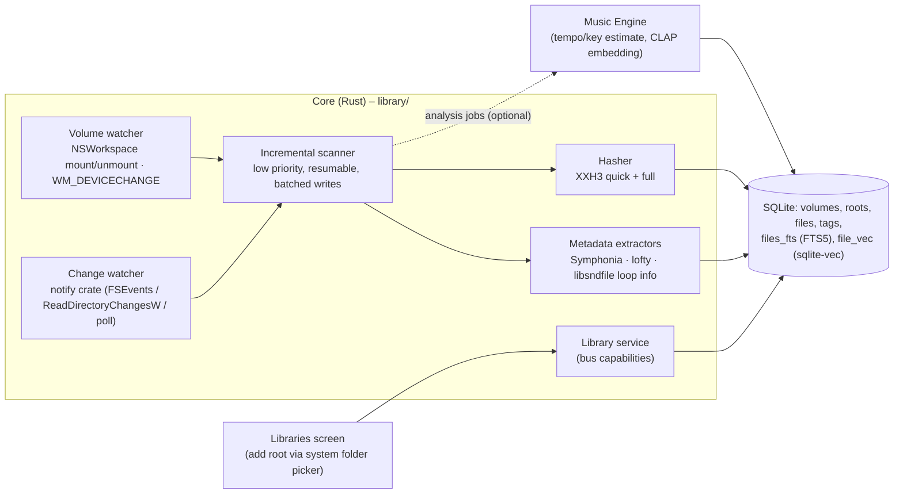

# Spec – Smart Library Multidrive (Prompt 03 §5, deliverable 8)

Version 0.1 · 2026-11-24 · Status: PROVISIONAL (design; nothing implemented).
Knowledge: `docs/knowledge/smart-library/` (cited below as *KB §n*), permissions:
`docs/knowledge/security-permissions/` §1, §3.

## 1. Purpose and owner
Find, catalog and search the user's samples, loops, one-shots, MIDI files, presets and instrument
libraries on every **authorized** location (internal disk, external HDD/SSD, USB, custom folders,
NAS), keep a persistent local index that survives drives being unplugged and replugged, and answer
search requests from the agents.
- **Sub-agent owner:** Smart Library Agent. It reasons over search requests; the deterministic
  service in Core (`desktop/src-tauri/src/library/`) does scanning and indexing.
- **Consumers:** Rhythm Engineer and Sound Designer (pick the user's sounds), Reference Track
  (compatible material), Plugin Intelligence (preset files).

## 2. Scope
In scope: volume detection and identity, user-authorized roots, incremental scan, file watching,
metadata (format, duration, sample rate, embedded loop/tempo/key data, tags), BPM/key from filename,
one-shot/loop heuristic, duplicates, offline volumes, text + filter + similarity search.

Out of scope (owned elsewhere):
- Deep audio analysis of a single file (tempo/key estimation from audio, embeddings) → Audio
  Analysis Engine; the library *requests* it as a background job and stores the result.
- Preset internals and mapping presets to plugins → Plugin Intelligence (uses the `files` rows of
  kind `preset`).
- Moving, renaming or deleting user files: **never**, unless the user explicitly asks (Prompt 03 §5).
- Uploading anything to the cloud: never by default (KB §1).

## 3. Components

## 4. Pipeline
1. **Authorize a root.** User picks a folder in the system picker (implied consent on macOS; in a
   sandboxed build store a security-scoped bookmark) – KB §1, permissions §3. Removable/network
   volumes trigger their one-time macOS prompts. Full Disk Access is never requested.
2. **Identify the volume.** Build a fingerprint: macOS `volumeUUIDString` (may be nil); Windows
   volume GUID path + format serial; tie-breakers label, FS type, capacity (KB §2). Network shares:
   normalized `server/share` (to verify). Paths are stored as *(volume_id, path relative to volume
   root)*, never with a drive letter.
3. **Initial scan.** Walk the root; per file: kind by extension, size, mtime; extract metadata
   (Symphonia for format/duration/rate, lofty for tags, libsndfile `SFC_GET_LOOP_INFO` for
   ACID-style loop data – KB §5); BPM/key from filename regex (KB §5). Record every value with its
   **source** (`embedded | filename | analysis | user`) and a confidence.
4. **Hash.** XXH3 quick fingerprint (size + head/tail/middle blocks for files > 64 MB), full hash
   only on quick-hash collision (KB §4). Duplicates = same full hash.
5. **Categorize.** One-shot vs loop heuristic (embedded loop info, filename, duration ≈ whole bars,
   folder names) – KB §6. Instrument class from folder/filename now; CLAP embeddings later via the
   Engine.
6. **Index.** Upsert into `files`, `tags`, `files_fts`; embeddings into `file_vec` when computed.
7. **Keep current.**
   - Live watcher events = hints → incremental rescan of the affected subtree.
   - On launch, mount, overflow or "must scan subdirs" → incremental rescan of that root (KB §3).
   - NAS/SMB: polling (user-configurable interval) or manual rescan; exFAT/FAT USB: rescan on mount.
   - Incremental rule: same (size, mtime) → skip; else re-extract and re-hash.
8. **Unplug / replug.** Unmount → `online = 0`, records kept, shown greyed "drive offline: <label>".
   Mount → fingerprint match → online, incremental rescan. Unknown fingerprint whose files largely
   match an offline volume → **ask the user** to merge (KB §9). Missing files are flagged, purged
   only after a grace period or by the user.
9. **Search.** FTS5 text (name/path/tags, `trigram` for partial names) + structured filters (kind,
   BPM range, key, loop/one-shot, volume online) + optional similarity (sqlite-vec on CLAP vectors,
   or CLAP text embedding for "dark plucky synth") – KB §8, §10. The LLM gets result metadata only.

## 5. Tables used (local SQLite – to reconcile with `DATABASE.md`)
- `volumes(id, kind[internal|external|usb|network], fingerprint_json, label, fs_type, capacity_bytes, last_seen_at, online)`
- `library_roots(id, volume_id, rel_path, bookmark_blob, watch_mode[events|poll|manual], poll_interval_s, added_at, last_scan_at, scan_state)`
- `files(id, volume_id, root_id, rel_path, ext, kind[audio|midi|preset|other], size, mtime, quick_hash, full_hash, duration_ms, sample_rate, channels, bit_depth, bpm, bpm_src, bpm_conf, musical_key, key_src, key_conf, is_loop, loop_src, missing_since, indexed_at)` – unique (volume_id, rel_path)
- `file_tags(file_id, tag, source[user|filename|embedded|model], confidence)`
- `files_fts` (FTS5, external content over `files` + tags)
- `file_vec` (sqlite-vec `vec0`, file_id → CLAP embedding; model id + version stored alongside)
- `scan_jobs(id, root_id, kind[full|incremental|poll], state, files_seen, files_changed, started_at, finished_at, error)`

## 6. Capabilities on the bus

| Capability | Input | Output | Risk | Long job? |
|---|---|---|---|---|
| `library.list_volumes` | – | volumes with online state, roots | read | no |
| `library.add_root` | folder chosen by user in picker | root id, volume id | low (only index writes) | no |
| `library.remove_root` | root_id, keep_tags? | ok | medium (drops index rows; files untouched) | no |
| `library.scan` | root_id, mode full/incremental | job id → summary | read | **yes** |
| `library.search` | text?, filters (kind, bpm range, key, loop, online_only), similar_to?, limit | ranked files with metadata + value sources | read | no |
| `library.get_file` | file_id | full record, tags, duplicates | read | no |
| `library.find_duplicates` | root_id? | duplicate groups | read | yes |
| `library.tag` | file_id, tags | ok | low | no |
| `library.request_analysis` | file_ids | job id (delegates to Audio Analysis) | read | **yes** |

No capability moves, renames or deletes user files. A future "organize/copy" feature would be
**high** risk and confirmed per operation.

## 7. OS permissions
macOS: Files & Folders (via picker), Removable Volumes, Network Volumes; Local Network only if a
NAS is reached by the app itself; never Full Disk Access. Windows: ordinary file ACLs; no prompt
(permissions §1).

## 8. Performance targets (targets, not measurements)
- Initial scan: metadata-only pass on 100k files in minutes, not hours, on an SSD; UI responsive throughout.
- Incremental rescan of an unchanged root: seconds (size/mtime check only).
- Search: < 100 ms for text + filters on 500k files.
- Scanner CPU at low priority; pausable when the DAW is playing (⏳ detection method).

## 9. Failure modes and honest reporting
- Every BPM/key carries `*_src` and `*_conf`; filename guesses are never presented as measured.
- Permission denied / volume gone mid-scan → job ends `partial` with the reason; index kept.
- Watcher overflow → automatic rescan, logged.
- Fingerprint ambiguous → user decides; no silent merge.
- Unreadable/corrupt file → indexed as `kind=other` with error tag, not dropped silently.

## 10. Limitations
- Windows volume GUID stability across different PCs and FSEvents behaviour on SMB/exFAT: to verify (KB open questions).
- No public spec for Apple Loops metadata or most preset formats: best-effort (KB §5, §7).
- Network shares: no reliable change events → polling delay.
- Filename BPM/key conventions are practice, not a standard.
- `sqlite-vec` is pre-v1: pin version, keep embeddings recomputable.

## 11. Acceptance tests (first implementation)
1. Add a folder on an external USB drive, scan, unplug → files shown offline with tags intact;
   replug on a different mount point / drive letter → same volume recognized, no duplicate rows.
2. Change one file → only that file re-extracted (verified by `scan_jobs.files_changed = 1`).
3. Two identical samples in different folders → one duplicate group.
4. `Loop_Dark_128bpm_Fm.wav` → bpm 128 / key F minor with `src = filename`; a WAV with an ACID
   chunk → values with `src = embedded` (libsndfile loop info).
5. Search "kick" with `kind=audio, is_loop=false` returns only one-shots, < 100 ms on a 100k-row test DB.
6. No network request is made during scan/search (checked with a test that blocks network access).
7. Removing a root deletes index rows only; file count on disk unchanged.
