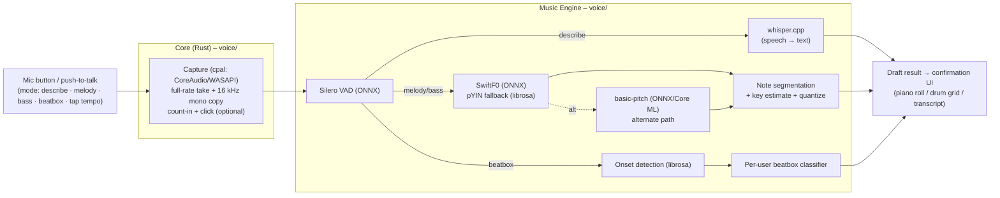

# Spec – Voice-to-Music (Prompt 03 §6, deliverable 9)

Version 0.1 · 2026-11-24 · Status: PROVISIONAL (design; nothing implemented).
Knowledge: `docs/knowledge/voice-to-music/` (*KB §n*), `docs/knowledge/midi-intelligence/`
(composition guide §9 quantization, §12 checklist), permissions: `docs/knowledge/security-permissions/` §1–2.

## 1. Purpose and owner
Let the user sing, whistle, hum, vocalize a bassline, beatbox a rhythm or **describe** an idea, and
turn it into usable material: a transcript for the Prompt Engine, a MIDI melody/bassline, or a drum
pattern – always shown for confirmation before anything reaches the DAW.
- **Sub-agent owner:** Voice-to-Music Agent. Music Theory refines key/scale snapping; Rhythm
  Engineer refines drum patterns (via the central Agent, never directly).
- **Code:** capture in Core (`desktop/src-tauri/src/voice/`, `cpal`); analysis in the Music Engine
  (`engine/cosound_engine/voice/`).

## 2. Scope
In scope: mic capture with OS permission, optional count-in + click, VAD, explicit input modes,
speech-to-text (IT/EN), monophonic pitch tracking, note segmentation, key estimate, quantization,
beatbox → drum MIDI with per-user calibration, confidence on every result.

Out of scope: polyphonic voice transcription, lyrics alignment, singing synthesis, voice cloning,
sending audio to the cloud (all processing is local by default, KB §11.5), wake word (later phase,
see `docs/knowledge/music-memory/`).

## 3. Components

## 4. Pipeline
1. **Permission.** First mic use → macOS `NSMicrophoneUsageDescription` prompt (+ hardened-runtime
   audio-input entitlement); Windows: global + "desktop apps" microphone switches. If the stream is
   silent/blocked, tell the user and deep-link to settings (detection method on Windows: to verify)
   – KB §10.
2. **Mode.** The user picks a mode on the mic button (most reliable, KB §7). If "auto", VAD +
   pitch-stability heuristic proposes speech vs singing and the UI shows which branch ran.
3. **Capture.** Keep the full-rate take (saved in the project workspace as an artifact) and a
   16 kHz mono copy for analysis. When timing matters (melody to be quantized, beatbox), record
   with **count-in + click at the project BPM** – the key design rule from KB §8.
4. **Describe branch.** whisper.cpp (multilingual, IT/EN) → transcript → Prompt Engine → Production
   Brief shown to the user with music terms normalized (KB §2).
5. **Melody / bass branch.** SwiftF0 with `fmin/fmax` set to the mode's range (bass mode: low range,
   then octave transposition) → frame pitch + confidence → segmentation (voicing, pitch stability,
   onsets) → median pitch per note → key estimate (medium reliability; ≥ 8 bars better) → optional
   snap-to-scale and quantize to the click grid (strength user-set) → MIDI notes with velocity from
   loudness. pYIN cross-checks low-confidence regions; basic-pitch is the alternate path (KB §3–4).
6. **Beatbox branch.** Onset detection → per-onset features → nearest-neighbour/small classifier
   against the user's calibration samples (kick, snare, closed hat, open hat; "make your kick 5
   times") → quantize → GM drum notes (KB §6, midi-intelligence GM map).
7. **Tap tempo.** Onsets → inter-onset intervals → BPM with confidence.
8. **Confirm.** UI shows notes/drum grid, detected BPM/key with confidence, original take for A/B.
   User edits; only the confirmed result becomes a `midi` artifact the agents can use.

## 5. Tables used (local SQLite – to reconcile with `DATABASE.md`)
- `voice_takes(id, project_id, mode[describe|melody|bass|beatbox|tap], audio_artifact_id, sample_rate, duration_ms, click_bpm, created_at)`
- `voice_results(id, take_id, kind[transcript|notes|drums|tempo], payload_json, bpm, bpm_conf, musical_key, key_conf, overall_conf, engine_versions_json, confirmed_at, midi_artifact_id)`
- `beatbox_calibration(id, user_local_id, class[kick|snare|hh_closed|hh_open], features_blob, sample_artifact_id, created_at)`
- Shared: `artifacts` (canonical columns in `../DATABASE.md`) (owned by DATABASE.md)

## 6. Capabilities on the bus

| Capability | Input | Output | Risk | Long job? |
|---|---|---|---|---|
| `voice.record` | mode, count_in_bars?, click_bpm?, max_s | take id + audio artifact | low (mic + workspace write) | no (user-bounded) |
| `voice.transcribe_speech` | take_id, language? (it/en/auto) | transcript, language, segments | read | short |
| `voice.transcribe_melody` | take_id, range (melody/bass), key_hint?, quantize?{grid, strength} | notes (pitch, start, dur, vel, conf), bpm?, key + conf, midi artifact (draft) | read | short |
| `voice.transcribe_beatbox` | take_id, grid | drum hits (class, time, conf) → drum MIDI draft | read | short |
| `voice.calibrate_beatbox` | class, takes | calibration saved | low | no |
| `voice.tap_tempo` | take_id | bpm + conf | read | no |
| `voice.confirm_result` | result_id, user edits | confirmed midi artifact | low | no |

Nothing here touches the DAW; inserting the confirmed MIDI is a separate DAW Controller op.

## 7. OS permissions
Microphone only (macOS TCC + entitlement; Windows privacy switches). No network needed: models ship
with the app or are downloaded once on first use (⏳ packaging decision in `DECISIONS.md`).

## 8. Performance targets (targets, not measurements)
- Speech: transcript within ~2 s after the user stops talking for a 10 s utterance on a recent laptop.
- Melody: notes on screen within ~1 s after a 15 s take (SwiftF0 and VAD are small ONNX models, KB §3, §7).
- Live pitch display while singing: streaming SwiftF0 (176 ms lookahead per KB §3) – later phase.
- Memory: voice models loaded on demand, unloaded after idle.

## 9. Failure modes and honest reporting
- Every note, BPM and key has a confidence; low-confidence notes are drawn differently and never
  silently "fixed".
- BPM from a short free hum is **not** inferred: the UI asks for the BPM or a click take (KB §8
  rates it low reliability).
- Absolute pitch drift → offer "snap to key" instead of changing notes without asking.
- Silent/blocked mic → explicit message, not an empty result.
- Speech on a non-speech take (or vice versa) → result says which branch ran; user can re-run in another mode.
- Beatbox without calibration → still runs with low confidence and asks to calibrate.

## 10. Limitations
- Beatbox → drums is research-grade, 4 classes (KB §6); no permissive off-the-shelf tool.
- Key from short phrases is ambiguous (relative major/minor).
- Windows built-in speech API offline behaviour unverified → whisper.cpp on both OSes.
- SwiftF0 accuracy figures are author-reported; basic-pitch Python package stops at 3.11 → use its
  ONNX/Core ML model, not the package (KB §3–4).
- madmom models are non-commercial → not used (KB §5).

## 11. Acceptance tests (first implementation)
1. Mic denied → clear message + settings link; granting it and retrying works without restarting.
2. Speech "techno in la minore a 124 BPM" (Italian) → transcript containing those terms; Prompt
   Engine brief has key A minor, BPM 124.
3. A sung C-major scale against a 120 BPM click → 8 notes C4…C5 (±0 semitones after snap), quantized
   to 1/8, confidence reported.
4. Same scale sung a quarter-tone flat → raw notes flagged lower confidence; "snap to key" restores the scale.
5. Bass mode on a hummed line → notes transposed to bass register (MIDI 28–55 range per composition guide register map, Default).
6. Beatbox after calibration (kick/snare/hat) on a 4-bar loop → ≥ 90% class accuracy on the test
   set of the tester's own takes (target), correct grid positions.
7. No audio or transcript leaves the machine (network blocked in test → feature still works).
