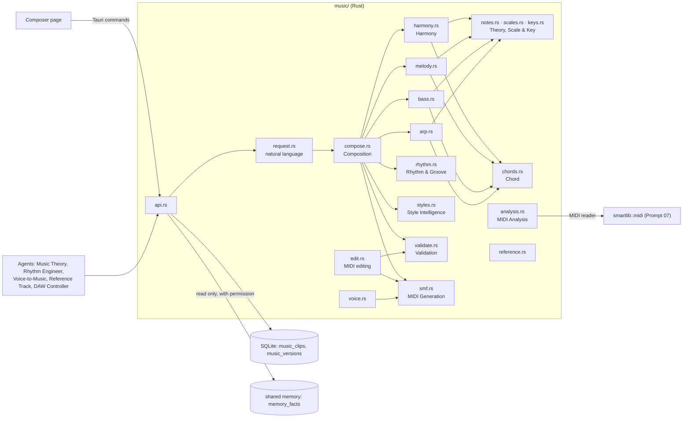

# Music Intelligence Engine – technical architecture (Prompt 09)

Version 1.0 · 2026-11-27. Code: `desktop/src-tauri/src/music/` (Rust) and the Composer page
`desktop/src/pages/Composer.tsx`. Style profiles: `packages/music-styles/styles.json`. Report:
[PROMPT-09-REPORT.md](PROMPT-09-REPORT.md). Limits: [LIMITATIONS.md](LIMITATIONS.md). Decision: ADR-014 in
`docs/architecture/DECISIONS.md`.

The Music Intelligence Engine is a **deterministic, rule-based engine**. It extends the M2 music engine (Prompt 05)
instead of replacing it. The agents of Prompt 06 (Music Theory, Rhythm Engineer, Voice-to-Music, Reference Track,
DAW Controller…) are thin layers that call it. The engine has no second Central Agent and no memory of its own:
musical preferences are read from the shared memory, only with the user's permission. No language model writes
notes. Every output comes from music theory rules and is checked by the Validation engine before it is returned.

## 1. Modules

| Module | Engine (Prompt 09) | Job |
|---|---|---|
| `notes.rs` | Music Theory | Note names in Italian (Do, Re, Fa diesis, Sib) and English; enharmonics; pitch ↔ MIDI ↔ frequency, with deviation in cents; intervals by letter and by semitones (quality, number, compound, consonance), IT/EN names |
| `scales.rs` | Scale & Key | 33 scales (major and its modes, melodic and harmonic minor with their modes, pentatonics, blues, chromatic, whole tone, two octatonics, augmented, double harmonic, Hungarian minor, hirajoshi). Each scale has degrees, character and usual contexts in IT/EN, a source, diatonic chords and MIDI notes, and is spelled correctly from any tonic. `fitting` lists the scales that contain a set of notes |
| `keys.rs` | Scale & Key | Key parsing ("La minore", "F# minor", "Re dorico", "Am"); key signature, relative/parallel keys, circle of fifths, neighbour keys; modulation routes with pivot chords. Key **estimation** from notes returns ranked candidates with a confidence and flags weak cases (one dominant note, fewer than 3 pitch classes) |
| `chords.rs` | Chord | 36 chord types (triads, sus, 6, 7, 9, 11, 13, add, altered); symbols with Italian roots and slash bass; inversions, close/drop-2/spread voicings, voice leading between chords; recognition from notes with candidates, inversion and a tolerated omitted fifth |
| `harmony.rs` | Harmony | Roman-numeral analysis with functions (tonic, subdominant, dominant…), secondary dominants and borrowed chords; key from a chord list; cadences; explained substitutions (tritone, relative, modal interchange…). **Progression generation**: a functional grammar plus knowledge-base progressions, scored for style and mood, deduplicated, with optional 7th/9th/sus colours. Modal progressions |
| `melody.rs` | Melody | Seven styles (simple, progressive, hypnotic, emotional, minimal, cinematic, rhythmic). Phrase plan (motif → sequence → development → open/closed cadence), contour per style, climax placement, gap-fill after leaps. Every note gets a role: chord tone, passing, neighbour, approach, anticipation, suspension, cadence, climax. Seven **variations** (rhythmic, ornamental, progressive, inversion, new ending, octave, fragmentation) report how much of the original identity they keep |
| `bass.rs` | Bassline | Eleven styles (sub, melodic, rhythmic, syncopated, sequential, hypnotic, progressive, offbeat, rolling, house, pulse). It follows the harmony, can avoid the kick, and reports kick collisions and the share of chord tones |
| `arp.rs` | Arpeggio | Nine patterns (up, down, updown, downup, alternate, broken, random, pedal, chord), rate, octaves, gate and four velocity curves (flat, rise, fall, wave); follows the chord timeline |
| `rhythm.rs` | Rhythm & Groove | Grids including triplets and dotted values; positions "bar.beat.16th"; Euclidean rhythms; polyrhythms; swing; syncopation measure; quantize with strength; humanize; named grooves; patterns from words |
| `styles.rs` | Style Intelligence | 11 style profiles (techno, melodic techno, progressive house, deep house, house, tech house, minimal, EDM, trance, ambient, cinematic): tempo range, swing, mode weights, harmony, melody, bass, drums, arp and energy settings, each with sources. User files in `<app data>/music-styles/` override fields. Blends ("techno con elementi di ambient" → 70/30) average the numeric settings |
| `request.rs` | – | Natural language (IT/EN) → parts, moods, key, BPM, bars, styles with weights, melody/bass/arp styles. Words it did not understand are returned, never ignored silently |
| `compose.rs` | Composition | Request → key (request > memory > style), progression plus alternatives, parts (chords, bass, melody, arp, drums), CC74 filter ramp, validation, report of choices |
| `smf.rs` | MIDI Generation | Standard MIDI File format 1: conductor track (tempo, time signature, key signature), one track per part with program and CC events. PPQ 480 |
| `edit.rs` | MIDI editing | Requests in words (IT/EN) → operations: transpose, diatonic shift, octave, quantize, velocity, duration, legato, staccato, shift, humanize, syncopate, "more hypnotic", change of mode, inversion, retrograde, simplify. Refuses to push notes out of the MIDI range. `diff` measures what changed |
| `analysis.rs` | MIDI Analysis | Reads any `.mid` (through the Smart Library reader, rescaled to PPQ 480): tempo and its source, key candidates, chords per bar, progression in roman numerals, per-track range, intervals, phrases, repeated patterns, grid. Notes outside the key are **described** (chromatic passing, blue note, borrowed…), never marked as errors |
| `validate.rs` | Validation | Findings with a severity and a kind: **technical_error** (zero length, notes past the end, outside the MIDI range, overlapping same-pitch notes), **stylistic_choice** (a semitone clash with a held chord tone, melody below the bass, dissonance against the bass, an outside note with no recognised function, long silences), **compositional_freedom** (an outside note with a recognised function: chromatic passing or neighbour, blue note, borrowed). Only technical errors fail the check |
| `voice.rs` | Voice-to-Music bridge | Notes estimated from singing (Hz or fractional MIDI + onset and length) → tempo, grid, key candidates, intervals, suggested chords, MIDI. Pitches are only rounded to the nearest semitone (deviation in cents reported); they move into the key **only** if correction is asked |
| `reference.rs` | Reference Track bridge | Reads a reference with every fact tagged by source (`audio_analysis` = measured by COSOUND, `web`, `user`); closest style. `compose_inspired` reuses only general traits (key, tempo, style) and checks originality: a progression different from the reference and melodic similarity below 0.5, up to 20 attempts |
| `api.rs` | API | Entry points for the app and the agents; clip store with versions (compose, edit, variation), undo, compare, export to `<app data>/generated/music/*.mid` |

M2 modules still used: `theory.rs` (keys, diatonic chords, interval names), `generate.rs` (drums, deterministic
`Rng`), `arrangement.rs`, `caps.rs` (sketches and base64).

## 2. A request, step by step
"Crea una melodia emozionale e ipnotica in tonalità di La minore, adatta a una produzione Melodic Techno a 124 BPM":
1. `request::parse` → parts `[melody]`, moods `[emotional, hypnotic]`, key A minor, 124 BPM, style
   `melodic_techno` 1.0, no unknown words.
2. `styles` → melodic techno profile (modes, phrase length, density, melody style "hypnotic"/"emotional").
3. `harmony::generate` → several progressions in A minor scored for the style and the moods; the best one is used,
   the others are offered as alternatives.
4. `melody::compose` → 8 bars on the chord timeline, with motif, repetition and cadence; each note with its role.
5. `validate::check` → technical errors 0; stylistic choices and freedoms listed.
6. `api::compose_api` → stored as clip version 1, with the report; `export` writes the `.mid` file.

## 3. Determinism, reproducibility, performance
- Every generator takes a `seed`: the same request with the same seed gives the same notes; another seed gives a
  variant. The seed is stored in the report.
- Scales, chord types and grammars are static tables compiled into the program, so there is nothing to rebuild or
  cache at run time. Style profiles are a few KB of JSON, read on each request so user overrides apply at once.
- A full 8-bar composition (chords, bass, melody, arp, drums) with validation and MIDI takes a few milliseconds:
  the 44 compositions of the style test run in 0.28 s in a debug build.
- Long operations (file analysis) run as async commands; the UI stays responsive.
- Errors are typed (`Err(String)` in the engine, `AgentError` codes in the agents); a request the engine cannot
  satisfy says why instead of returning something approximate.

## 4. Database (migration `005_music.sql`)
| Table | Content |
|---|---|
| `music_clips` | id, title, request text, key, BPM, bars, style, chord timeline (JSON), composition report (JSON), dates |
| `music_versions` | clip, version number, operation (compose / edit / variation / import), description, key, tracks (JSON: name, channel, program, notes, CC) |

Version 1 is never deleted by undo. Preferences are **not** stored here: they stay in `memory_facts`.

## 5. API
**Engine** (`music::api`): `theory(input)` with `what` = note, interval, scale, scales, key, circle, modulation,
chord, chord_types, recognize_chord, estimate_key, options; `harmony_api` (generate, analyze, substitutions,
modal); `rhythm_api` (pattern, euclid, polyrhythm, swing, quantize, humanize, grooves); `compose_api`; `clips`,
`clip`, `edit_clip`, `vary_clip`, `undo`, `compare`, `export`; `analyze_file`, `analyze_notes`; `voice_api`;
`reference_api`.

**App commands:** `music_theory`, `music_harmony`, `music_rhythm`, `music_style_list`, `music_compose`,
`music_clips`, `music_clip`, `music_edit`, `music_vary`, `music_undo`, `music_compare`, `music_export_clip`,
`music_analyze_file`, `music_voice`, `music_reference`.

**Agents** (Agent API, usable by the partner's Central Agent; the MOCK test runs the prompt example through it):
- Music Theory: `theory`, `generate_progressions`, `analyze_progression`, `substitutions`, `compose`,
  `vary_melody`, `edit_midi`, `get_clip`, `undo_edit`, `compare_versions`, `export_midi`, `analyze_midi`, `validate`,
  `style_profiles` (new) plus the M2 operations `key_info`, `progression`, `generate_chords`, `generate_bassline`,
  `generate_melody`, `detect_key`, `check_coherence`.
- Rhythm Engineer: `rhythm_pattern`, `humanize` (new).
- Voice-to-Music: `notes_to_music` (new, available). Transcription from audio stays planned (engine M5).
- Reference Track: `compose_inspired` (new).
- DAW Controller: unchanged; it receives the exported `.mid` through `plan_operations` (tempo, key, instrument
  track, `import_midi`).

New tools in `packages/agents/tools.json`: `music.notes`, `music.scales`, `music.keys`, `music.chords`,
`music.harmony`, `music.melody`, `music.bass`, `music.arpeggio`, `music.rhythm`, `music.styles`, `music.composer`,
`music.midi_editor`, `music.midi_analysis`, `music.validation`, `music.voice_bridge`, `music.reference_bridge`.
New permission: `memory.music` (Settings → "Preferenze musicali", off by default).

## 6. Rules the engine keeps (Prompt 09)
- **The user's idea comes first.** Voice input is not corrected unless asked. Edits change only the part named.
  Memory fills gaps and never overrides what the request says; the report says when memory was used.
- **Out of key is not wrong.** Analysis and validation describe outside notes by function; only technical problems
  are errors.
- **Sources stay separate.** Measured facts, external facts and the user's facts are labelled; styles and theory
  facts carry their source.
- **Originality.** Reference-inspired material is checked against the reference; reference melodies and
  progressions are never reproduced.
- **No silent guesses.** Words not understood, weak key estimates and missing data are reported.
