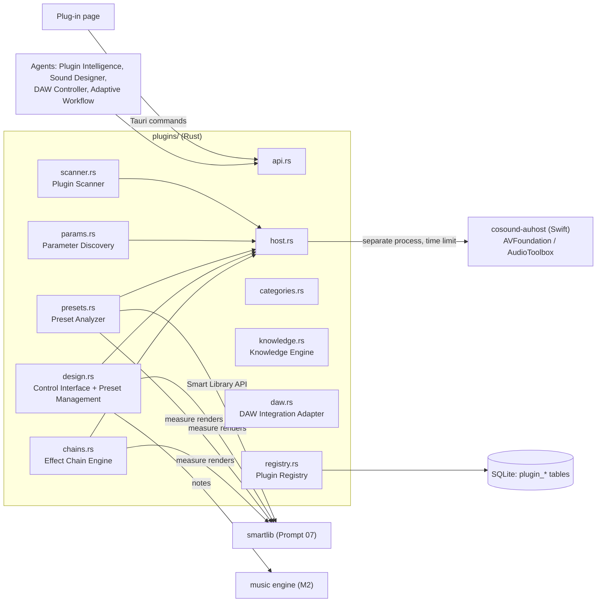

# Plugin Intelligence System – technical architecture (Prompt 08)

Version 1.0 · 2026-11-26. Code: `desktop/src-tauri/src/plugins/` (engine) and `desktop/src-tauri/auhost/main.swift`
(isolated Audio Unit host). Report: [PROMPT-08-REPORT.md](PROMPT-08-REPORT.md). Verified formats and plug-ins:
[FORMATS.md](FORMATS.md). Limits: [LIMITATIONS.md](LIMITATIONS.md).

The Plugin Intelligence System is a **technical engine**. The Plugin Intelligence and Sound Designer agents
(Prompt 06) are thin layers that call it. There is no second Central Agent and no second memory: plug-in habits go to
the shared memory through the Adaptive Workflow agent.

## 1. Modules

Recognition, technical knowledge and operational control are separate modules:

| Module | Job |
|---|---|
| `scanner.rs` | Walks only the documented plug-in folders. macOS: `/Library` and `~/Library/Audio/Plug-Ins/{Components,VST3,CLAP,VST}`, plus Avid's AAX folder. Windows: `Common Files\VST3`, `\CLAP`, `\VST2`, `\Avid\Audio\Plug-Ins`, `Program Files\VSTPlugins` and `Steinberg\VSTPlugins`, and the per-user VST3/CLAP folders. It reads `Info.plist` (version, bundle id, `AudioComponents`), VST3 `moduleinfo.json` (vendor, version, sub-categories, SDK) and executable headers (Mach-O / PE) for CPU architectures. On macOS it merges the system **Audio Unit registry**, which also covers Apple's built-in units and AUv3 app extensions. A bundle that macOS does not register is flagged |
| `registry.rs` | Database sync. One **product** per plug-in, with one **install** per format, so AU, VST3 and CLAP versions of the same plug-in are not duplicated. An install that disappears is marked *missing* with a date and comes back on reinstall. DAW compatibility is computed by format from the knowledge base and marked *documented*. Search covers name, vendor, category and function (Italian/English words). Error log |
| `categories.rs` | Multiple categories per product, each with a source and a confidence. Sources, strongest first: declared AU tags or VST3 sub-categories, knowledge base, name words. Instrument categories: synth, sampler, drum machine, rompler, piano, bass, orchestral, acoustic, generator. Effect categories: EQ, compressor, limiter, multiband, saturation, distortion, reverb, delay, chorus, flanger, phaser, filter, stereo, modulation, creative, analyzer, pitch, utility |
| `knowledge.rs` | Official documentation as JSON with source and version: `packages/plugin-knowledge/apple-au.json` holds 33 Apple units and 211 parameters, extracted from Apple's `AudioUnitParameters.h`, SDK 15.5. Updatable: any `<app data>/plugin-knowledge/*.json` file overrides it. Synth profiles and effect facts come from the knowledge base. When nothing is documented it says so |
| `host.rs` + `auhost/main.swift` | The isolated host. `list` reads the AU registry and loads nothing. `describe` loads a unit and returns its parameter tree (address, name, unit, range, value, writable) and factory presets, optionally after applying a preset. `render` runs an offline render: instrument, effect chain, parameter values and ramps, MIDI notes or an input audio file → 24-bit WAV; it can save each unit's state as an `.aupreset` and **refuses to overwrite**. Every call is a separate process with a time limit: a hang is killed, a crash is reported, COSOUND keeps running |
| `params.rs` | Stores the real parameters per install and plug-in version. It maps each one to a **sound role** (cutoff, resonance, drive, attack, release, LFO, unison, detune, octave, dry/wet, reverb decay, threshold …) from its name, unit and the plug-in category. A parameter with no recognized role is shown, never moved automatically. Factory presets are stored too |
| `presets.rs` | Finds presets in three places: factory presets, the standard preset folders (VST3 SDK and Apple conventions; files are attributed by the AU codes inside `.aupreset`, or by `<Vendor>/<Plug-in>/` folders), and the Smart Library through its API (not copied). Semantic search over presets that really exist, with reasons. Timbre: an AU preset is rendered with test notes and measured by the Smart Library analyzer |
| `design.rs` | Sound design. Choice of the instrument: installed, loadable, the user's remembered choice first. It adds the effects a recipe needs when the instrument lacks the control, sets starting values from the knowledge-base recipes, uses notes from the music engine (key, genre, BPM), and supports a progressive filter opening (automation). It turns requests in words (IT/EN: *più aggressivo*, *mantienilo caldo*, *meno scuro*…) into parameter changes on real parameters; "keep" qualities limit opposing moves. **Audition** renders before and after and measures both; each quality is checked on the measure that reflects it, and the level is checked. **Save** writes new `.aupreset` files (one per unit) plus the chain JSON in COSOUND's folder. **Install** copies them into the plug-in's user preset folder (approval, permission). **Undo** removes only what COSOUND copied |
| `chains.rs` | Chains for four goals (techno bass, melodic lead, atmospheric pad, mix bus), each stage with its purpose (IT/EN), starting settings and knowledge-base source. Order rules. Adaptation to the measured audio (crest factor, brightness, low end, correlation, peaks). Each stage is mapped to an installed effect whose name fits its function. **Check** renders the audio through the chain and measures output peak/true peak and RMS change |
| `daw.rs` | Per DAW (Logic Pro first, then Ableton Live, REAPER, FL Studio, Cubase, Pro Tools), the status of seven plug-in operations: available / planned (connector) / none, with route and source. It also builds the setup plan handed to the DAW Controller |

## 2. Interaction levels (Prompt 08 §8)
These are computed per install from what was actually done on this computer (`api::levels`):

| Level | Meaning in COSOUND |
|---|---|
| recognized | found by the scanner or the AU registry |
| hosting | COSOUND can load it (AU/AUv3 on macOS, available) or not, and why |
| analyzed | parameters read from the plug-in |
| parameters available / controllable / with a sound role | counts from the real parameter tree |
| presets found / readable | factory, preset folders |
| presets modifiable | new presets from the plug-in's own state; originals never overwritten |
| control verified | date of the last render with changed parameters in COSOUND's host |
| control inside the DAW | not verified: needs the DAW connector (milestone M4) |

## 3. Interaction routes, in order of preference (Prompt 08 §8)
1. **Official APIs / SDK** – Apple's AVFoundation/AudioToolbox, used by `cosound-auhost` for Audio Units. **Operational.**
2. **Parameters exposed by the DAW** – through the DAW connectors (ReaScript, Live Object Model, Scripter/MCU/OSC for
   Logic). **Planned (M4).**
3. **Official automation and scripting** – same connectors. **Planned.**
4. **GUI control** – not built; it would be used only when verified per plug-in.

## 4. Database (migration `004_plugins.sql`)
| Table | Content |
|---|---|
| `plugin_products` | id (normalized vendor/name), name, vendor, kind, available, first_seen, last_verified |
| `plugin_installs` | id (format + path, or AU codes), product, format, name, vendor, version, path, scope (system/user/apple/app_extension), os, archs, au_code, bundle_id, registered, status (available/missing/incompatible/error) + reason, details (declared categories, DAW compatibility, control_verified_at …), last_verified, missing_since |
| `plugin_categories` | product, category, source, confidence |
| `plugin_params` | install, address, identifier, name, unit, range, default, writable, role, plug-in version, discovery date |
| `plugin_presets` | product, install, source (factory/preset_folder/cosound), name, number, path, format, category, readable, details (incl. measured timbre) |
| `plugin_errors` | install, operation, error, date (diagnostics) |
| `plugin_designs` | sound designs and chains: request, spec, base spec, changes, status, files written |

## 5. API
**Engine** (`plugins::api` and modules): `refresh`, `overview`, `detail`, `levels`, `compare`, `audition`;
`registry::list`; `params::discover`; `presets::{scan, search, analyze}`;
`design::{create, modify, save, install_preset, remove_installed, remember_instrument, list, get}`;
`chains::{propose, check, check_order}`; `daw::{capabilities, setup_plan}`.

**App commands:** `plugins_scan`, `plugins_overview`, `plugins_list`, `plugins_detail`, `plugins_discover`,
`plugins_presets_search`, `plugins_preset_analyze`, `plugins_compare`, `plugins_chain`, `plugins_daw`,
`plugins_design_{create, modify, audition, save, install, uninstall, get, plan}`, `plugins_designs`, `plugins_remember`.
Each checks its Settings permission.

**Agents** (Agent API, usable by the partner's Central Agent; the MOCK test runs the Prompt 08 example through it):
- Plugin Intelligence: `scan`, `list`, `find_for_role`, `plugin_info`, `map_parameters`, `find_presets`,
  `analyze_preset`, `compare`, `propose_chain`, `check_chain`, `daw_capabilities`, `diagnostics`; `control_in_daw`
  is planned.
- Sound Designer: `design_sound`, `modify_sound`, `audition`, `save_preset`, `install_preset` and
  `remove_installed_presets` (both need the user's approval), `list_designs`; `program_synth` (inside the DAW) is
  planned.
- DAW Controller: `plugin_setup_plan`.
- Adaptive Workflow: `remember_plugin_preference`, `plugin_preferences`.

## 6. Collaboration with the other engines
- **Music Intelligence:** `design::notes_for` asks the music engine for a bass line, chords or melody in the
  requested key, genre and BPM, and only plays them. The sound and the notes stay separate.
- **Smart Library:** preset search calls `smartlib::api::search_structured`. Renders are measured with
  `smartlib::analyze`. No library data is copied into plug-in tables.
- **DAW Controller:** gets a setup plan per DAW. It alone talks to DAWs.
- **Memory:** usual instrument, preset or chain per role live in `memory_facts` (category `plugin`). They are written
  only on explicit request, with the workflow-memory permission.

## 7. Privacy and security
- Only documented plug-in and preset folders are read. There is no disk-wide scan, and authorized library folders
  are reached only through the Smart Library.
- Plug-ins and original presets are never modified or deleted. Saved presets are new files (unique names, the
  helper refuses to overwrite).
- Writing into a plug-in preset folder needs the *Write presets* permission (off by default) and the user's
  approval. It is logged in `op_log` with its undo.
- Loading plug-ins needs the *Load plug-ins* permission, and runs in a separate process with a time limit.
- Licenses are never checked, and no credentials are read.

## 8. Build and distribution
`build.rs` compiles `auhost/main.swift` with the Command Line Tools on macOS into
`binaries/cosound-auhost-<target>`. `tauri.macos.conf.json` bundles it as an external binary next to the app
executable; this was verified in `COSOUND.app`. On Windows and Linux nothing is compiled, and hosting reports
"not available".
