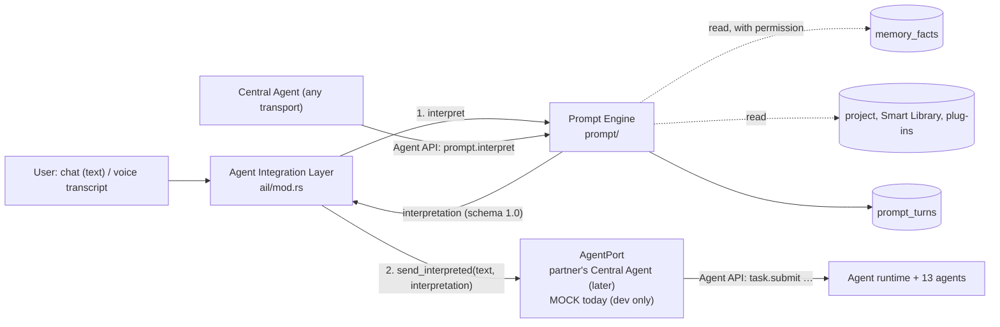

# Prompt Engine – technical architecture (Prompt 10)

Version 1.0 · 2026-11-27. Code: `desktop/src-tauri/src/prompt/` (Rust). Contract:
`packages/contracts/prompt-interpretation.schema.json` ([SCHEMA.md](SCHEMA.md)). Template:
`packages/prompt-templates/interpret.v1.json`. Report: [PROMPT-10-REPORT.md](PROMPT-10-REPORT.md).
Limits: [LIMITATIONS.md](LIMITATIONS.md). Decision: ADR-015 in `docs/architecture/DECISIONS.md`.

The Prompt Engine **understands and structures**. It turns a user turn (typed text, or a voice transcript from
COSOUND's input system) into a versioned JSON *interpretation* for the partner's Central Agent. It does not plan,
choose an order, coordinate agents or execute anything: it is not a second Central Agent. It keeps no memory of its
own: it reads the shared memory (`memory_facts`) with the user's permissions, and stores only its own turns for
conversation continuity and traceability.

## 1. Where it sits

- Every turn typed in the chat is interpreted first; the interpretation is shown to the user ("Cosa ho capito") and
  handed to the port with the text. A port that ignores it gets the plain text (`AgentPort::send` default).
- The Central Agent can also call `prompt.interpret` through the Agent API, for example with a voice transcript.
- Without the Central Agent the interpretation is still produced and shown; nothing is executed.

## 2. Modules

| Module | Prompt 10 component | Job |
|---|---|---|
| `text.rs` | Natural Language Understanding (base) | Normalization (case, apostrophes, punctuation, "124bpm" → "124 bpm", "%"), phrase matching on word boundaries, language detection (it / en / unsupported languages recognised by their words), number words ("un paio" = 2), sanitization (control and invisible bidi characters removed, length cap) |
| `lexicon.rs` | NLU vocabulary | IT/EN words for 19 production elements, 8 sections, 19 intents, conversation acts (undo, restore, confirm, cancel, correction, follow-up), destructive operations, unsupported requests, code-execution requests, instruction-like text in external content |
| `constraints.rs` | Constraint Management | "non modificare X", "mantieni X", "solo/soltanto X", "usa soltanto i miei sample", "senza X", "non eliminare", "non modificare il file originale" → preserve / only / exclude / resource_restriction / no_delete / no_overwrite, with scope request / session ("da ora in poi") / permanent ("sempre"). Constraint words are **masked** before intent and target detection |
| `extract.rs` | Musical Parameter Extraction | General (genre and blends, BPM only next to "bpm"/"tempo", key, length in bars, duration, mood, references as said), rhythm (pattern, groove, swing %, syncopation, density, intensity), harmony (scale, chord-symbol runs, roman-numeral runs, tension, resolution), sound (qualities with direction and amount, sound type, stereo image), structure (sections), technical (dB with sign and "approximate", Hz, LUFS, level direction). Contradictions and impossible values are reported. Missing values are never invented. Reuses `music::request`, `music::keys`, `music::scales`, `music::chords` and `plugins::design` |
| `intent.rs` | Intent Recognition | 19 intents, several per request, from cues **and** meaning: creation verbs + parts → composition; comparatives ("più largo") change existing material and cancel "creation"; "cerca un kick secco" is a search, not sound design; MIDI edit words in a creation request describe the new part. Conversation acts: new request, modification, correction, undo, restore, confirm, cancel, question, smalltalk |
| `context.rs` | Context Interpretation | Context from the caller (project, DAW, tracks with roles, selected track, section, plug-ins, libraries, files, recent operations, preferences) plus COSOUND's own data (open project, library and plug-in counts). References: named elements matched to tracks by role and name; "questo elemento", "rendilo", "it" resolved by selection, then by the conversation, otherwise a question |
| `safety.rs` | Destructive operations, security | Deleting tracks or regions, overwriting files, replacing presets, restructuring, exporting over a file, clearing memory → flagged with subject and reversibility; "elimina il riverbero" is not a track deletion. External content is data; instruction-like text in it is reported and ignored. Requests to run code are refused. Unsupported requests (publishing, purchases, downloads, messages) get an alternative |
| `enhance.rs` | Prompt Enhancement | Four separate layers: the user's words, the semantic interpretation, suggested technical aspects (from the knowledge base), and the operations actually authorized. Suggestions are never authorizations |
| `instructions.rs` | Structured Instruction Generator | One instruction per competent component: agent (registry id), purpose, inputs, constraints, suggested operation (only if it exists in the registry), whether it is available today, approval and destructive flags. No order, no execution |
| `profile.rs` | Assistant personalization | Name (never replaces the COSOUND brand), reply language (auto / it / en), style (friendly, professional, concise, technical), detail (brief, normal, detailed), mode (proactive, confirm_first, step_by_step), operative preferences. Writes the reply; Italian articulated prepositions ("del basso", "nel drop") |
| `model.rs` | Model Adapter, templates, budgets | `ModelAdapter` trait, `NotConnected` adapter, versioned templates, rendering with data delimiters that user values cannot close, structured output validated against the schema, deterministic checks, fallback to the rules, daily request / token / cost limits, configuration without secrets |
| `api.rs` | API | `interpret`, `validate` (schema with local `$ref`s resolved), `history`, `reset`; the pipeline below |

## 3. Pipeline of one turn (`api::interpret`)
1. **Sanitize**: control and invisible characters removed, 4,000-character cap (reported).
2. **Language**: Italian or English; another language → `language_not_supported`, nothing sent on.
3. **Profile and history**: assistant profile; previous turn and previous actionable turn of the same session.
4. **Context**: caller's context + open project + library and plug-in counts + memory (only with
   "Preferenze musicali" / "Memoria dei workflow" permissions).
5. **Constraints** (masked) + session constraints from earlier turns + permanent instructions from memory.
6. **Parameters**, **intents**, **targets**, **conversation act**; follow-ups inherit the element; corrections keep
   the request and change the element.
7. **Ambiguities** in three situations (Prompt 10 §6): A *missing_optional* → declared default (style tempo/key);
   B *missing_recoverable* → project or memory; C *missing_essential*, unresolved references, contradictions, low
   transcript confidence → one short question. With a question pending, **no instruction is produced**.
8. **Issues**: not understood, contradictory, impossible, incompatible (unusual BPM for a style), missing
   resources, unsupported or planned operations, unsafe input, external instructions ignored, too long.
9. **Safety**: destructive operations; a constraint that forbids what the request destroys → question.
10. **Instructions**, **approval** (destructive, writes outside COSOUND or to shared memory, or the
    confirm-first interaction mode), **goal**, **enhancement**, **expected output**, **confidence**.
11. **Validation** against the schema; optional **model refinement**; **reply** in the user's language and style;
    validation again; the turn is stored in `prompt_turns`.

## 4. Model-agnostic design (Prompt 10 §17)
- The rules always run and always produce a valid interpretation: COSOUND works offline and with no model.
- A model, local or cloud, is added by implementing `ModelAdapter::complete(system, user, max_tokens)`. Nothing else
  changes. Configuration (`prompt_model_config` setting): provider, model, endpoint (credentials refused), template,
  output-token cap, timeout, daily request / token / cost limits. Usage is counted per day (`prompt_model_usage`).
- Template `interpret.v1` (`packages/prompt-templates/`) is versioned with a changelog; every placeholder must be
  filled; user text, context, previous turn, external content and the rules' pre-analysis are in separate delimited
  blocks, and the values cannot close those delimiters.
- The model's answer must be JSON that validates against the schema. From it COSOUND accepts only the goal wording,
  the semantic enhancement, extra inferred parameters (BPM 20–300 and parsable keys only; never one the user already
  said) and extra ambiguities. Identity, input, constraints, approvals, destructive flags, issues and instructions
  always come from the rules. Rejected values are listed in `interpreter.rejected_model_values`.
- Any failure (no model, error, timeout, invalid JSON, schema violation, budget reached) → the rules' interpretation
  with `interpreter.fallback = true` and the reason.
- Deterministic musical functions (music, plug-in, library engines) never depend on a language model.

## 5. Security and privacy (Prompt 10 §18)
- Input validation: type, length, control and bidi characters; session ids bounded.
- External content is data: never parsed for intents; instruction-like text is reported and ignored; in templates it
  is inside `<data>`, separated from the system instructions.
- No code execution: a prompt never becomes a command or code; such requests are refused with an explanation.
- No execution at all: the engine produces data. Destructive operations need the user's approval through the
  existing Safety Gate (Prompt 06): the Central Agent cannot approve.
- Permissions: memory is read only with the user's toggles; nothing is written to memory by the engine (permanent
  instructions become an `adaptive_workflow.remember` instruction that needs approval).
- Traceability: every interpretation is stored locally in `prompt_turns` (request id, session, act, intent, text,
  JSON); the user can start a new conversation or clear a session. Nothing leaves the computer.
- Personal data: the user id is `local` unless the Central Agent provides one.

## 6. Database (migration `006_prompt.sql`)
| Table | Content |
|---|---|
| `prompt_turns` | request_id, session_id, turn, source (text/voice), language, act, primary_intent, text, interpretation (JSON), created_at |

## 7. API
**Engine:** `prompt::api::{interpret, validate, schema, history, reset}`, `prompt::profile::{load, set, reply}`,
`prompt::model::{ModelAdapter, NotConnected, template, render, refine, load_config, save_config}`.

**Agent API** (for the Central Agent): `prompt.interpret`, `prompt.history`, `prompt.schema`
(`docs/agents/AGENT-PROTOCOL.md`).

**AIL:** `AgentPort::send_interpreted(text, interpretation, api)` – default falls back to `send(text, api)`;
`AgentEvent::Interpretation` is sent to the UI before anything else; `Ail::new_session`.

**App commands:** `prompt_interpret`, `prompt_history`, `prompt_new_session`, `prompt_reset_session`,
`prompt_schema`, `assistant_profile`, `assistant_profile_set`, `prompt_model_config`, `prompt_model_config_set`.

## 8. MOCK Central Agent (simulation, development builds only)
`ail/temp_test_connector.rs` receives the interpretation and, to test the path end to end, runs only instructions
that are available, need no approval, are not destructive and only read or create new material in COSOUND
(`music_theory.compose`, `smart_library.search`, `smart_library.suggest_loops`, `plugin_intelligence.find_for_role`).
Everything else is listed as "waiting for the Central Agent or the user's approval". It is labelled as a simulation in
every message and will be deleted when the partner's adapter exists.
