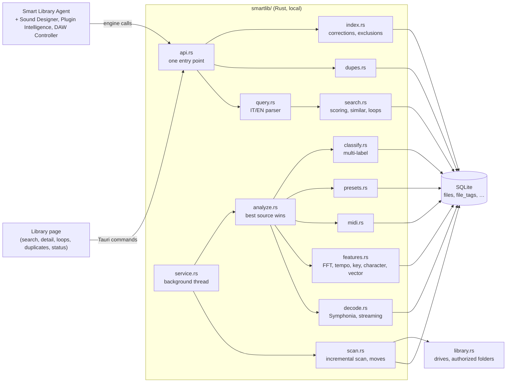

# Smart Library System – technical architecture (Prompt 07)

Version 1.0 · 2026-11-26. Code: `desktop/src-tauri/src/smartlib/` (engine) and `desktop/src-tauri/src/library.rs` (drives and
authorized folders). Report: [PROMPT-07-REPORT.md](PROMPT-07-REPORT.md). Formats: [FORMATS.md](FORMATS.md). Limits:
[LIMITATIONS.md](LIMITATIONS.md).

The Smart Library is a **technical engine**, not an agent. It scans, analyzes, classifies, indexes and searches. The
**Smart Library Agent** (`agents/smart_library.rs`, Prompt 06) is a thin layer that turns Agent API requests into engine calls.
It adds no logic of its own and no second index. There is no new Central Agent: requests from the partner's Agent reach the
engine only through the Agent API.

## 1. Components

| Module | Job |
|---|---|
| `library.rs` | Drive detection (sysinfo), drive identity (fingerprint), authorized folders, drive kind (internal / external / USB / network) |
| `scan.rs` | Walks one authorized folder. Rows are updated in place, so file ids stay stable. Detects new, changed, moved (same size + content fingerprint, or same name + size), missing and returned files. Skips hidden entries and excluded subfolders. Records each run in `scan_jobs`; interrupted runs are resumed at the next start |
| `decode.rs` | Streams audio through Symphonia 0.6 in packets: the whole file is never held in memory. Can be cancelled. Reads WAV `acid`/`smpl` loop chunks |
| `features.rs` | Loudness meter (BS.1770, shared with `audio/wav.rs`), FFT 2048/hop 1024: centroid, roll-off, flatness, five bands, zero crossings, onsets, attack/decay, tempo (autocorrelation of onset strength, whole-bar loop lengths preferred), key (chroma + Krumhansl via `music::theory`), root note, loop/one-shot, sound character, a 14-value timbre vector |
| `midi.rs` | Standard MIDI File reader: tracks, notes, tempo, time and key signatures, programs, range, intervals, polyphony, pattern type, rhythm, bars |
| `presets.rs` | Reads documented preset formats (see FORMATS.md). Plugin taken from the file, or from folder names via the synth catalog |
| `classify.rs` | Multiple labels per file (category, type, genre, descriptor, plugin), each with source and confidence. Sources are name, folders, metadata, audio, MIDI and preset |
| `analyze.rs` | Runs the readers for one file and picks the best estimate per field: user > embedded > analysis ≥ 0.5 > metadata > file name > weak analysis. Writes columns and labels, keeps user labels, re-applies user corrections |
| `index.rs` | User corrections (`file_corrections`), excluded subfolders and drives, statistics |
| `query.rs` | Deterministic Italian/English parser: categories, types, genres, descriptors, key (also Italian note names and `Am`, `F#m`), mode, BPM, BPM range, lone tempo numbers, bars, duration, formats, kind, plugin, drive. What it does not understand is kept as free text. No AI involved |
| `search.rs` | SQL pre-filter then weighted scoring with a "why" list. Also similar sounds (timbre vector), fitting loops (stretch % and key fit) and file details |
| `dupes.rs` | Duplicates in three levels: identical bytes (full SHA-256, only for size collisions), same audio in another container (SHA-256 of decoded 16-bit samples), similar sounds (≥ 97 %, reported as **not** duplicates). Nothing is deleted |
| `service.rs` | One background thread. It checks drives every 15 s and scans the folders of a drive when it comes back. At start it scans every online folder. Optional scheduled rescans (setting `library_rescan_minutes`). Analysis runs in batches of 16 with a pause between files (`library_analysis_pause_ms`, default 15 ms). It pauses while a DAW runs (`library_pause_during_daw`) or when the user pauses it (`library_analysis` = `paused`). It emits the events `library-scan` and `library-analysis` |
| `api.rs` | The one entry point used by the UI commands and by the agents |

## 2. Data flow

1. **Authorize** (user only, system folder dialog) → `library_roots` row tied to a `volumes` row.
2. **Scan** (incremental). An unchanged file (same size and mtime) is not even opened. New and changed files get
   `analysis_state = 'pending'`. A rescan of 100,000 unchanged files takes 0.9 s.
3. **Analyze** (background, low priority). Decode up to the first 90 s, then compute features, MIDI and preset data. Classify,
   choose the best estimates, store, and re-apply user corrections.
4. **Search**. The parser produces a `Query`. SQL narrows candidates (kind, format, duration, device, tags, text), then
   scoring adds weights per matched criterion. Every result carries `why`, and every estimate carries `source` and
   `confidence`.
5. **Use**. Agents and the DAW Controller receive file ids, then `resolve` gives the current original path. The path is null
   when the drive is offline, and the DAW Controller then fails with `FILE_NOT_AVAILABLE`.

## 3. Database and index structure

Local SQLite (`cosound.db`), migration `desktop/src-tauri/migrations/003_smartlib.sql`. Full table list:
`docs/architecture/DATABASE.md` §2.1.

| Table | Content |
|---|---|
| `volumes` | Drive identity, kind, label, mount point, online, last seen; `excluded` (added by 003) |
| `library_roots` | Authorized folders: drive + relative path, scan state, file count |
| `files` | One row per indexed file, with a stable id. 001 columns: root, rel_path, name, ext, kind, size, mtime, bpm/key from the name. 003 adds `status` (present / modified / moved / missing), `missing_since`, `moved_from`, `quick_hash`, `full_hash`, `audio_hash`, `indexed_at`, analysis state/version/error/date, `format`, `duration_s`, `sample_rate`, `channels`, `bit_depth`, `peak_dbfs`, `rms_dbfs`, `lufs`, `bpm` + `bpm_src` + `bpm_conf`, `musical_key` + `key_src` + `key_conf`, `is_loop`, `loop_bars`, `category` (primary), `details` (JSON: features, metadata, MIDI or preset data), `vec` (JSON timbre vector) |
| `file_tags` | Multi-label classification: (file, tag, kind) → source, confidence. Kinds: category, type, genre, descriptor, plugin |
| `file_corrections` | User corrections, re-applied after every analysis: `bpm`, `key`, `add:<kind>:<tag>`, `remove:<kind>:<tag>` |
| `library_exclusions` | Subfolders of an authorized folder that are never scanned |
| `scan_jobs` | One row per scan with counts (seen, new, changed, moved, missing, back), state and error |

Indexes are on status, category, bpm, size, the three hashes, analysis state and `file_tags(tag)`.

**Hashes.** `quick_hash` is a SHA-256 of size + first and last 64 KiB. It is computed only when needed (move detection,
duplicates). `full_hash` is the SHA-256 of the whole file, computed only for files whose size collides with another.
`audio_hash` is the SHA-256 of the decoded samples quantized to 16 bit; it matches the same audio in WAV, AIFF, FLAC or
ALAC.

## 4. Integration API

### 4.1 Engine (Rust, `smartlib::api`)
| Function | Returns |
|---|---|
| `search_text(c, text, limit, kind)` | `{ understood, count, results[] }`: the parsed request and scored results with `why` |
| `search_structured(c, &Query, limit)` | The same, for callers that already have structured criteria |
| `resolve(c, ids)` | Original path (null when offline), `usable`, device, status, format |
| `detail(c, id)` | Everything known about a file, with source and confidence per estimate |
| `similar(c, id, limit)` | Sounds with similar timbre, as a % estimate (results under 10 % are dropped) |
| `loops(c, bpm, key, category, limit)` | Loops with `fit.stretch_percent` and key fit. Files are never modified |
| `duplicates(db, cancel, include_similar)` | `identical_files[]`, `same_audio[]`, `similar_not_duplicates[]` |
| `overview(c)`, `analysis_status(c)`, `formats()` | Statistics, per-folder state, exclusions, analysis counts, format lists |
| `scan(db, root_id, cancel)` | Scan summaries (used by the agent `scan` operation) |

### 4.2 Desktop app (Tauri commands)
`library_scan(id)` ("" = all), `library_cancel`, `library_query(text, kind, limit)`, `library_detail(id)`,
`library_similar(id)`, `library_loops(bpm, key, category)`, `library_duplicates(similar)`, `library_overview`,
`library_correct(id, field, value)`, `library_exclude(root_id, folder, excluded)`,
`library_exclude_device(volume_id, excluded)`, plus `library_volumes`, `library_roots`, `library_add_root`,
`library_remove_root` (from Prompt 04). Events: `library-scan` `{root_id, count, done, error, summary}` and
`library-analysis` `{analyzed}`.

### 4.3 Agents (Agent API, Prompt 06)
Smart Library Agent: 13 operations, all available. They are `search`, `describe_sound`, `find_similar`, `suggest_loops`,
`find_presets`, `find_midi`, `file_info`, `find_duplicates`, `stats`, `volumes`, `scan`, `analyze_now` and
`analysis_status`. Schemas are in `packages/agents/smart_library.json`, and the generated table is in
`docs/agents/AGENTS.md` §H.

Other agents call the engine directly through their tools, never through another agent:
- Sound Designer: presets in the library.
- Plugin Intelligence: `presets_in_library` per plugin.
- DAW Controller: `library_file_id` in import parts, resolved to the original path; offline gives `FILE_NOT_AVAILABLE`.
- Audio Analysis, Mixing and Mastering: `audio.decoder` for non-WAV files.

## 5. Privacy and permissions
- Local-first: nothing leaves the computer, and there is no network code in `smartlib/`.
- Only folders the user authorized are read, minus excluded subfolders and drives. Hidden entries are skipped.
- Original files are opened read-only, and never moved, renamed, modified or deleted. Duplicates are only reported.
- Agents get paths only through `resolve`, and the agent runtime still checks `files.authorized_read`.
- User corrections are logged in `op_log` (op `library.correct`).

## 6. Performance (measured on this Mac, release build, 2026-11-26)
| Library size | Initial scan | Rescan, nothing changed | Text search (50 results) |
|---|---|---|---|
| 20,000 files | 0.16 s | 0.09 s | ≈ 20 ms |
| 100,000 files | 1.65 s | 0.89 s | ≈ 115 ms |

Audio analysis takes ≈ 40–55 ms per 8-second loop and ≈ 0.6 s for a 7-minute MP3 (first 90 s analyzed). It runs in the
background with a pause between files, so a large library is analyzed over minutes, not instantly; this is by design.
The test is `smartlib::tests::large_library` (`COSOUND_LIB_FILES` sets the size).

## 7. Tests
- **Unit and integration tests**: `cargo test --features temp-connector`, 67 passing.
  - Smart Library suite: `smartlib/tests.rs` plus module tests in decode, features, midi, presets, classify and query.
  - Agent tests: `agents/tests.rs`.
- **Manual tests**, which need real material:
  - `--ignored real_files` (files encoded by other software);
  - `--ignored real_drives` (internal disk + exFAT disk image attached and detached, macOS);
  - `--ignored large_library` (performance).
